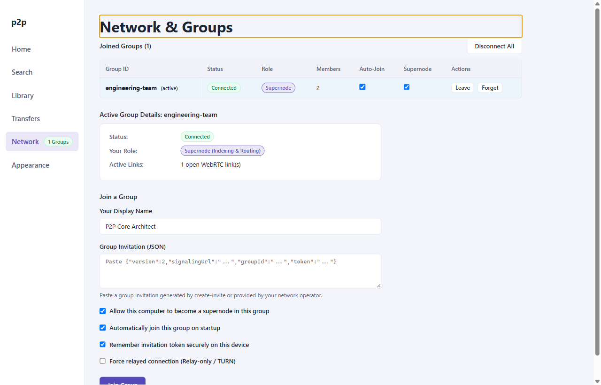

# p2p-multiple-groups

[](https://nodejs.org/)
[](https://www.electronjs.org/)
[](https://react.dev/)
[](https://www.typescriptlang.org/)
[](https://github.com/shinyishi/werift-webrtc)

An encrypted, multi-group, hybrid peer-to-peer (P2P) file sharing system and signaling infrastructure. `p2p-multiple-groups` unites a FastTrack-inspired two-tier overlay network with modern cryptographic security boundaries, pure Node.js WebRTC transport, and an Electron desktop interface. Peers dynamically organize into self-healing virtual clusters, electing distributed supernodes via Highest Random Weight (HRW) consistent hashing to route catalog indexes without centralized bottlenecks.

The core engineering challenge addressed by this architecture is **secure multi-group multiplexing over pooled peer-to-peer associations**. Rather than establishing redundant WebRTC connections or leaking routing knowledge across security boundaries, the system aggregates multiple virtual groups over single SCTP transport associations. It enforces strict per-group cryptographic token authorization, dynamic capability grant revocation, monotonic membership leases, and sliding-window backpressure to protect bandwidth-constrained leaf nodes.

---

## Preview



*Figure 1: Production desktop interface displaying active virtual groups, WebRTC connection states, supernode roles, and real-time membership rosters.*

---

## Core Capabilities

- **Two-Tier Hybrid Overlay**: Nodes automatically partition into bandwidth-rich supernodes and resource-conserving ordinary peers. Supernodes maintain local inverted indexes and route queries, dropping query complexity from $O(N)$ network flooding to $O(S)$ targeted supernode exchange.
- **Rendezvous (HRW) Consistent Hashing**: Deterministic, seedless supernode assignment using 256-bit hash weight functions. Peer departure causes minimal $\frac{1}{|S|}$ client reassignment without cascading re-hashes or hash-ring rebalancing storms.
- **Virtual Multi-Group Multiplexing**: Peers participate in independent security boundaries (`[signalingUrl, groupId]`) concurrently. Underlying WebRTC peer connections are shared and demultiplexed at the control and data channel layers with zero cross-group information leakage.
- **Renewable Freshness Leases**: Authoritative signaling state machines issue monotonic sequence numbers (`epoch`, `membershipRevision`) with active leases ($\tau_{\text{lease}} = 6000\text{ ms}$, heartbeat $\tau_{\text{hb}} = 2000\text{ ms}$). Roster staleness triggers automatic failover and local grant invalidation.
- **SCTP Backpressure & Flow Control**: Chunked $16\text{ KiB}$ binary transfer protocol with cumulative sliding-window ACKs ($256\text{ KiB}$ interval), $512\text{ KiB}$ inflight window caps, high/low watermark stream suspension ($256\text{ KiB}$ / $128\text{ KiB}$), and stall watchdog timers.
- **Cryptographic File Integrity**: End-to-end SHA-256 verification streaming directly through Node.js crypto primitives. Incomplete transfers are staged in hidden `.tmp.<transferId>` files and atomically renamed only upon cryptographic digest verification.
- **Zero-Trust Desktop Sandboxing**: Main process isolates WebRTC network primitives and file I/O. The React 19 renderer operates in complete context isolation with zero Node integration, locked down by strict Content Security Policy (`connect-src 'none'`) and origin-validated IPC channels.
- **Hardware-Backed Credential Security**: Group authentication tokens and signaling credentials persist through OS-level keychains via Electron `safeStorage` (Windows DPAPI, macOS Keychain, Linux Secret Service / DBus) with seamless fallback to non-persistent session memory.

---

## Verified Tech Stack

| Layer | Technologies & Dependencies | Purpose |
|---|---|---|
| **Runtime & Host** | Node.js `24.18.0` (engines `>=24.12.0`), Electron `44.4.1` | Native desktop runtime, sandboxed multi-process host, OS keychain integration |
| **P2P Transport** | Werift `^0.24.4` (pure Node WebRTC), `ws` `^8.21.3` | User-space DTLS 1.2, SRTP, SCTP data channels, WebSocket signaling |
| **Frontend UI** | React `19.3.0`, React DOM `19.3.0`, TypeScript `5.9.3` | Reactive desktop interface, keyboard navigation, accessible theme system |
| **Tooling & Build** | Vite `7.3.6`, `electron-vite` `5.0.0`, `@vitejs/plugin-react` `5.2.0` | Multi-target compilation (main, preload, renderer), bundle optimization |
| **Testing & E2E** | Node Test Runner (`node:test`), Chrome DevTools Protocol (CDP) | Headless multi-engine verification, integration testing, automated UI visual capture |

---

## Quick Start

### Prerequisites

- **Node.js**: Version `>=24.12.0` (verified on `v24.18.0`).
- **npm**: Version `>=10.0.0`.
- **Platform**: Windows 10/11, macOS 12+, or modern Linux (Ubuntu 22.04+).

### Installation & Development

```bash
# Clone the repository
git clone https://github.com/your-org/p2p-multiple-groups.git
cd p2p-multiple-groups

# Install dependencies
npm install

# Compile application bundle
npm run build

# Start the desktop application in development mode (with HMR)
npm run dev
```

### Starting the Signaling Server

You can launch the signaling server either using Docker Compose or directly via Node.js:

```bash
# Option 1: Launch via Docker Compose (using root .env)
cp .env.example .env
npm run docker:up

# Option 2: Launch directly via Node.js (auto-loads root .env)
cp .env.example .env
npm run signal:start

# Generate a group invitation or short invite code
npm run signal:invite -- --group-id=general-group
# Or print short invite code only:
npm run signal:invite -- --group-id=general-group --code-only
```
### Running the Test Suite

```bash
# Execute unit tests (stores, migration, crypto, wire codecs)
npm run test:unit

# Execute multi-peer integration suite (signaling, elections, transfers, security)
npm run test:p2p

# Execute full Electron desktop E2E suite via Chrome DevTools Protocol
npm run test:e2e

# Run all test suites consecutively
npm test
```

---

## User Interface Tour

| Screen | Description |
|---|---|
| **[Home](docs/assets/home-view.png)** | Central dashboard with system health, active group counters, and quick navigation shortcuts (`Ctrl+K`). |
| **[Network & Groups](docs/assets/network-view.png)** | Multi-group inspector, active roster table, supernode role assignment, and group join form. |
| **[Shared Library](docs/assets/library-view.png)** | Local file inventory, background SHA-256 hashing pipeline, and fine-grained group grant toggles. |
| **[Search & Discovery](docs/assets/search-view.png)** | Scoped multi-group search query interface, tokenized boolean matching, and swarm source selection. |
| **[Transfers](docs/assets/transfers-view.png)** | Real-time upload and download progress bars, chunk speed metrics, route type (Direct vs Relayed), and cancellation controls. |
| **[Appearance](docs/assets/appearance-view.png)** | Theme personalization engine supporting System, Dark, and Light palettes with immediate persistence. |

---

## Interactive Documentation Suite

The repository includes a modern, self-contained **Interactive HTML Documentation Suite** with dark/light theme switching, instant client-side keyword search (`Ctrl+K`), tabbed schemas, zoomable lightbox screenshots, and Mermaid diagrams:

```bash
# Open interactive HTML documentation in your default browser:
npm run docs:open
```

You can also browse the documentation directly in your browser by opening `docs/index.html`, or consult the markdown references:

| Section | Target Audience | Key Contents |
|---|---|---|
| **[Interactive Portal](docs/index.html)** ([Hub](docs/README.md)) | All contributors & operators | Master documentation portal, high-level architecture diagram, role-based reading tracks. |
| **[Source Code &amp; Syntax Guide](docs/code-guide/01-js-ts-react-syntax-in-codebase.html)** ([Markdown](docs/code-guide/01-js-ts-react-syntax-in-codebase.md)) | Developers, exam candidates, code reviewers | JS/TS/React 19 syntax deep-dive, file-by-file codebase walkthrough, 30+ code locators, 32-question inquiry exam bank. |
| **[JS/TS & npm Guide](docs/user-guide/00-js-ts-npm-fundamentals.html)** ([Markdown](docs/user-guide/00-js-ts-npm-fundamentals.md)) | Beginners & developers | Foundations of JS, TS, Node, npm, package.json, tsconfig, and complete 16-command CLI reference. |
| **[User Guide](docs/user-guide/01-getting-started.html)** ([Markdown](docs/user-guide/01-getting-started.md)) | End users, QA testers, developers | Step-by-step guides for setup, group management, sharing, search, and transfers. |
| **[Theory & Mathematics](docs/theory/01-distributed-topology.html)** ([Markdown](docs/theory/01-distributed-topology.md)) | Distributed systems architects | Mathematical topology proofs, HRW consistent hashing, NAT traversal RFCs, flow control math. |
| **[Internal Architecture](docs/architecture/01-system-overview.html)** ([Markdown](docs/architecture/01-system-overview.md)) | Core engineers & security reviewers | IPC contracts, `PeerEngine` lifecycle, complete wire protocol specification, storage engines. |
| **[Operations & Deployment](docs/operations/01-cloud-deployment.html)** ([Markdown](docs/operations/01-cloud-deployment.md)) | DevOps, SREs, infrastructure hosts | Production Azure VM setup, coturn TURN configuration, TLS renewal, Render.com IaC, test pipelines. |

## License

This project is licensed under the MIT License. See the [LICENSE](LICENSE) file for details.
