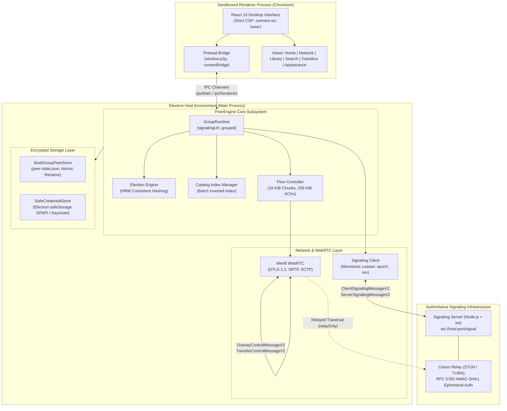

# Documentation Hub

Welcome to the comprehensive technical documentation suite for **`p2p-multiple-groups`**.

> **Interactive Documentation Portal Available**: You can browse the modern, self-contained HTML documentation suite with interactive search, dark/light themes, and lightbox zoom by opening [`docs/index.html`](index.html) or running `npm run docs:open`.

This repository implements an encrypted, multi-group, hybrid peer-to-peer (P2P) file sharing architecture. It synthesizes FastTrack-style two-tier overlay networks with modern Interactive Connectivity Establishment (ICE / RFC 8445), Highest Random Weight (HRW) consistent hashing elections, Werift pure Node.js WebRTC data channels, and sandboxed Electron execution.
---

## System Architecture Overview

The system is partitioned into three decoupled execution domains: the **Authoritative Signaling Layer**, the **Electron Main Process (P2P Engine & Host)**, and the **Sandboxed React 19 Renderer (Desktop UI)**.

---

## Role-Based Reading Tracks

Depending on your engineering focus, follow one of the curated reading tracks below:
### Track 0: Software Engineers, Inquiry Candidates, and Code Reviewers
Focuses on language syntax fundamentals (JS/TS/React 19), full file-by-file codebase walkthroughs, quick code locator tables, and a 32-question inquiry exam bank.
1. [01. JS/TS & React 19 Syntax in Codebase](code-guide/01-js-ts-react-syntax-in-codebase.md) — Core JS, ES Modules, TypeScript type system, generics, type guards, promise serialization, and React 19 hooks.
2. [02. Shared Contracts, Preload Bridge & Signaling Code](code-guide/02-shared-preload-and-signaling-code.md) — Build configuration, IPC channel contracts, input validators, wire protocol type guards, and signaling server.
3. [03. Main Process & P2P Engine Core Walkthrough](code-guide/03-main-process-and-p2p-engine-code.md) — Electron host lifecycle, IPC origin filters, HRW election, hardware credential storage, library indexing, and flow control.
4. [04. React Renderer UI & Inquiry Test Q&A Bank](code-guide/04-renderer-ui-and-inquiry-qa.md) — Sandboxed React 19 views, usePeerState hook, swarm aggregation, 30+ code locator table, and 32-question viva defense Q&A.

### Track 1: End Users, QA Testers, and Application Operators
Focuses on running the application, managing group memberships, configuring file grants, initiating transfers, and troubleshooting common operational hurdles.
1. [00. JS, TS & npm Fundamentals](user-guide/00-js-ts-npm-fundamentals.md) — JavaScript, TypeScript, Node.js, npm, package.json, tsconfig, and complete 16-command CLI reference.
2. [01. Getting Started](user-guide/01-getting-started.md) — System requirements, desktop workspace layout, and keyboard shortcuts.
3. [02. Network & Virtual Groups](user-guide/02-network-and-groups.md) — Group keys, invitations, keychain persistence, and privacy mode.
4. [03. Library & Sharing](user-guide/03-library-and-sharing.md) — File addition, SHA-256 background hashing, and fine-grained group grants.
5. [04. Search & Discovery](user-guide/04-search-and-discovery.md) — Multi-group tokenized boolean search and swarm source aggregation.
6. [05. Transfers & Flow Control](user-guide/05-transfers-and-downloads.md) — Inflight transfer monitoring, route types, integrity checks, and cancellation.
7. [06. Signaling Server Operations](user-guide/06-signaling-and-ops.md) — Local server execution, invitation generation, and health probing.
8. [07. Troubleshooting & FAQ](user-guide/07-troubleshooting-and-faq.md) — Error code encyclopedia, symmetric NAT diagnostics, and profile recovery.

### Track 2: Distributed Systems Engineers & Researchers
Focuses on the theoretical foundations, mathematical invariants, algorithmic proofs, and threat modeling of the hybrid overlay.
1. [01. Distributed Topology Foundations](theory/01-distributed-topology.md) — Evolution from Napster and Gnutella to Kazaa two-tier overlays; $O(N)$ vs $O(S)$ complexity proofs.
2. [02. Election & Consistent Hashing](theory/02-election-and-consistent-hashing.md) — Supernode election rules and Rendezvous (HRW) consistent hashing with minimal churn proofs.
3. [03. Virtual Overlays & Consensus](theory/03-virtual-overlays-and-consensus.md) — Transport pooling multiplexing, monotonic membership leases ($\tau_{\text{lease}} = 6000\text{ ms}$), and inverted search indexing.
4. [04. NAT Traversal & WebRTC](theory/04-nat-traversal-and-webrtc.md) — RFC 4787/3489 NAT mapping, ICE state machines, ephemeral HMAC-SHA1 TURN tokens, and Werift stack mechanics.
5. [05. Flow Control & Integrity](theory/05-flow-control-and-integrity.md) — SCTP sliding-window flow control ($16\text{ KiB}$ chunks, $256\text{ KiB}$ ACKs, $512\text{ KiB}$ cap) and atomic hash verification.
6. [06. Security Architecture & Threat Model](theory/06-security-and-threat-model.md) — Cryptographic isolation, constant-time validation, dynamic revocation, and sandbox defense-in-depth.

### Track 3: Core Contributors & Protocol Implementers
Focuses on the internal implementation mechanics, lifecycle state machines, wire protocol schemas, and local persistence engines.
1. [01. System Architecture Overview](architecture/01-system-overview.md) — Process layout, IPC security boundaries, sender validation, and component dependency graphs.
2. [02. PeerEngine Lifecycle & State](architecture/02-peer-engine-lifecycle.md) — Concurrency serialization queues (`policyQueue`), `GroupRuntime` internals, and state snapshot throttling.
3. [03. Wire Protocol Specification](architecture/03-wire-protocol-specification.md) — Complete message schemas for Signaling V2, Overlay Control V2, and Transfer Control V2.
4. [04. Storage, Persistence & Migration](architecture/04-storage-and-persistence.md) — `MultiGroupPeerStore` V2 disk layout, automatic legacy profile migration, and `SafeCredentialStore` encryption.

### Track 4: Cloud Infrastructure & DevOps
Focuses on production deployment of signaling instances, Coturn TURN servers, TLS certificate automation, and verification pipelines.
1. [01. Cloud Deployment & Coturn Setup](operations/01-cloud-deployment.md) — Production Azure VM configuration, `turnserver.conf`, systemd services, Nginx TLS proxying, and Render.com IaC.
2. [02. Testing Architecture & Verification](operations/02-testing-and-verification.md) — Unit test execution, multi-engine WebRTC integration suites, CDP Electron E2E automation, and verification checklists.

---

## Complete Documentation Index

| Directory | Document | Summary |
|---|---|---|
| `docs/code-guide/` | [01-js-ts-react-syntax-in-codebase.md](code-guide/01-js-ts-react-syntax-in-codebase.md) | JS/TS/Node/React 19 syntax deep-dive, block scoping, optional chaining, discriminated unions, promise queues. |
| `docs/code-guide/` | [02-shared-preload-and-signaling-code.md](code-guide/02-shared-preload-and-signaling-code.md) | electron.vite.config.ts, shared contracts, wire protocol, preload bridge, signaling server, token bucket rate limiter. |
| `docs/code-guide/` | [03-main-process-and-p2p-engine-code.md](code-guide/03-main-process-and-p2p-engine-code.md) | Main process entry, validateSender IPC 4-tier check, HRW election, credential store, inverted search index, transfers. |
| `docs/code-guide/` | [04-renderer-ui-and-inquiry-qa.md](code-guide/04-renderer-ui-and-inquiry-qa.md) | React 19 UI, usePeerState hook, swarm aggregation, 30+ code locator table, 32-question inquiry exam bank. |
| `docs/user-guide/` | [00-js-ts-npm-fundamentals.md](user-guide/00-js-ts-npm-fundamentals.md) | JavaScript, TypeScript, Node.js, npm, package.json, tsconfig, and complete 16-command CLI reference. |
| `docs/user-guide/` | [01-getting-started.md](user-guide/01-getting-started.md) | Setup instructions, workspace layout, shortcuts, and command palette navigation. |
| `docs/user-guide/` | [02-network-and-groups.md](user-guide/02-network-and-groups.md) | Group lifecycle, invitations, safe credential storage, auto-join, and privacy mode. |
| `docs/user-guide/` | [03-library-and-sharing.md](user-guide/03-library-and-sharing.md) | File grants, SHA-256 background hashing pipeline, and rescanning. |
| `docs/user-guide/` | [04-search-and-discovery.md](user-guide/04-search-and-discovery.md) | Group-scoped search queries, token matching, and result source selection. |
| `docs/user-guide/` | [05-transfers-and-downloads.md](user-guide/05-transfers-and-downloads.md) | Download workflows, real-time chunk monitoring, route inspection, and integrity checks. |
| `docs/user-guide/` | [06-signaling-and-ops.md](user-guide/06-signaling-and-ops.md) | Launching signaling nodes, issuing invitation tokens, and probing `/` health endpoints. |
| `docs/user-guide/` | [07-troubleshooting-and-faq.md](user-guide/07-troubleshooting-and-faq.md) | Standard error codes, symmetric NAT diagnosis, headless Linux keychain recovery, and backups. |
| `docs/theory/` | [01-distributed-topology.md](theory/01-distributed-topology.md) | P2P architecture history, mathematical query scaling comparison, and hybrid supernode justification. |
| `docs/theory/` | [02-election-and-consistent-hashing.md](theory/02-election-and-consistent-hashing.md) | Deterministic election predicates, HRW scoring equations, churn minimality proofs, and failover. |
| `docs/theory/` | [03-virtual-overlays-and-consensus.md](theory/03-virtual-overlays-and-consensus.md) | Transport pooling multiplexing, monotonic sequence leases ($\tau_{\text{lease}} = 6000\text{ ms}$), and inverted search. |
| `docs/theory/` | [04-nat-traversal-and-webrtc.md](theory/04-nat-traversal-and-webrtc.md) | NAT types, ICE candidate gathering, RFC 5766 HMAC-SHA1 ephemeral auth, and Werift pure Node WebRTC. |
| `docs/theory/` | [05-flow-control-and-integrity.md](theory/05-flow-control-and-integrity.md) | SCTP sliding-window flow control math, high/low watermark backpressure, and atomic hash verification. |
| `docs/theory/` | [06-security-and-threat-model.md](theory/06-security-and-threat-model.md) | Threat vectors, constant-time validation, dynamic capability revocation, OS encryption, and sandbox CSP. |
| `docs/architecture/` | [01-system-overview.md](architecture/01-system-overview.md) | Multi-process Electron design, IPC contract registry, origin sender validation, and component graphs. |
| `docs/architecture/` | [02-peer-engine-lifecycle.md](architecture/02-peer-engine-lifecycle.md) | Concurrency serialization queues, `GroupRuntime` state machines, and throttled UI dispatching. |
| `docs/architecture/` | [03-wire-protocol-specification.md](architecture/03-wire-protocol-specification.md) | Wire protocol specifications for Signaling V2, Overlay Control V2, and Transfer Control V2. |
| `docs/architecture/` | [04-storage-and-persistence.md](architecture/04-storage-and-persistence.md) | `MultiGroupPeerStore` schema, atomic rename staging, legacy migration, and `SafeCredentialStore`. |
| `docs/operations/` | [01-cloud-deployment.md](operations/01-cloud-deployment.md) | Azure VM production guide, Coturn configuration, systemd units, Nginx TLS proxying, and Render.com. |
| `docs/operations/` | [02-testing-and-verification.md](operations/02-testing-and-verification.md) | Unit testing, multi-peer integration harness, CDP Electron E2E automation, and regression checklists. |
