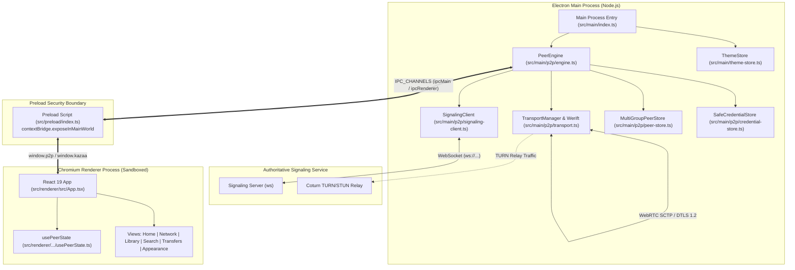

# Architecture: System Overview & Process Layout

This document details the multi-process execution topology of **`p2p-multiple-groups`**, the IPC bridge security boundary, and the dependency structure across runtime subsystems.

---

## 1. Multi-Process Execution Architecture

Electron executes the application across distinct OS processes to isolate low-level network and filesystem primitives from the graphical user interface.



### Process Roles & Boundaries

| Process | Runtime Environment | Responsibilities | Constraints |
|---|---|---|---|
| **Main Process** | Node.js `24.18.0` + Electron Host | Lifecycle management, single-instance lock (`requestSingleInstanceLock`), Werift WebRTC associations, disk persistence, OS keychain encryption, IPC dispatching. | Full host system access; must never execute unvalidated renderer strings. |
| **Preload Script** | Isolated Context | Bridges main and renderer processes using `contextBridge`. Exposes typed APIs `window.p2p` and `window.kazaa`. | Cannot import external npm modules or mutate global prototypes. |
| **Renderer Process** | Chromium + React 19 | Workspace UI, user interactions, view switching, theme rendering, form validation. | Sandboxed; strict CSP `connect-src 'none'`; `process`, `require`, and `Buffer` undefined. |
| **Signaling Service** | Independent Node.js Process | Authenticates group tokens, tracks roster membership, generates ephemeral TURN credentials, broadcasts SDP offers/answers. | Never inspects or stores file payloads; strictly metadata routing. |

---

## 2. IPC Contract Architecture

Communication between the sandboxed renderer and the main process is strictly mediated by the `IPC_CHANNELS` registry defined in `src/shared/contracts.ts`.

### Channel Registry

```typescript
export const IPC_CHANNELS = {
  THEME_GET: 'kazaa:theme:get',
  THEME_SET: 'kazaa:theme:set',
  COMMAND: 'kazaa:command',

  // Scoped V2 P2P Channels
  P2P_V2_GET_STATE: 'p2p:getState',
  P2P_V2_STATE: 'p2p:state',
  P2P_V2_JOIN_GROUP: 'p2p:joinGroup',
  P2P_V2_RESUME_GROUP: 'p2p:resumeGroup',
  P2P_V2_LEAVE_GROUP: 'p2p:leaveGroup',
  P2P_V2_SET_GROUP_AUTO_JOIN: 'p2p:setGroupAutoJoin',
  P2P_V2_SET_GROUP_ELIGIBILITY: 'p2p:setGroupEligibility',
  P2P_V2_FORGET_GROUP: 'p2p:forgetGroup',
  P2P_V2_DISCONNECT_ALL: 'p2p:disconnectAll',
  P2P_V2_ADD_FILES: 'p2p:addFiles',
  P2P_V2_RESCAN_LIBRARY: 'p2p:rescanLibrary',
  P2P_V2_REMOVE_FILE: 'p2p:removeFile',
  P2P_V2_SET_FILE_GROUPS: 'p2p:setFileGroups',
  P2P_V2_SEARCH: 'p2p:search',
  P2P_V2_DOWNLOAD: 'p2p:download',
  P2P_V2_CANCEL_TRANSFER: 'p2p:cancelTransfer'
} as const
```

### Sender Validation Invariant (`validateSender`)
Every single `ipcMain.handle` invocation executes `validateSender(event)` before evaluating logic:
1. Rejects if main window is destroyed.
2. Asserts `event.sender === mainWindow.webContents`.
3. Asserts `event.senderFrame.parent === null` (blocks execution from embedded child frames).
4. Verifies frame origin (`http://127.0.0.1:5173` in development; `file:///.../out/renderer/index.html` in production).

---

## 3. Bidirectional State Synchronization

State does not drift between processes:
1. **Invoking Actions**: The renderer invokes asynchronous actions via `window.p2p.p2p.*`. These map to `ipcRenderer.invoke(channel, ...args)`.
2. **Action Result Return**: Every action returns a typed `ActionResult`:
   $$\text{ActionResult} = \{ \text{ok}: \text{true} \} \mid \{ \text{ok}: \text{false}, \text{code}: \text{P2pErrorCode}, \text{message}: \text{string} \}$$
3. **Throttled State Publication**: Engine mutations trigger state broadcasts. To avoid overwhelming the React render cycle during rapid chunk transfers or catalog publication, the main process coalesces snapshots using a $200\text{ ms}$ trailing throttle timer:
   ```typescript
   function dispatchStateToWindow(state: MultiGroupP2pState & P2pState): void {
     pendingStateSnapshot = state
     if (!stateThrottleTimer) {
       stateThrottleTimer = setTimeout(() => {
         stateThrottleTimer = null
         if (pendingStateSnapshot && mainWindow && !mainWindow.isDestroyed()) {
           mainWindow.webContents.send(IPC_CHANNELS.P2P_V2_STATE, pendingStateSnapshot)
           pendingStateSnapshot = null
         }
       }, 200)
     }
   }
   ```
4. **Subscriber Ingestion**: In the renderer, `usePeerState` subscribes to `p2p:state`, updating the top-level React state hook and propagating changes to the workspace views.
