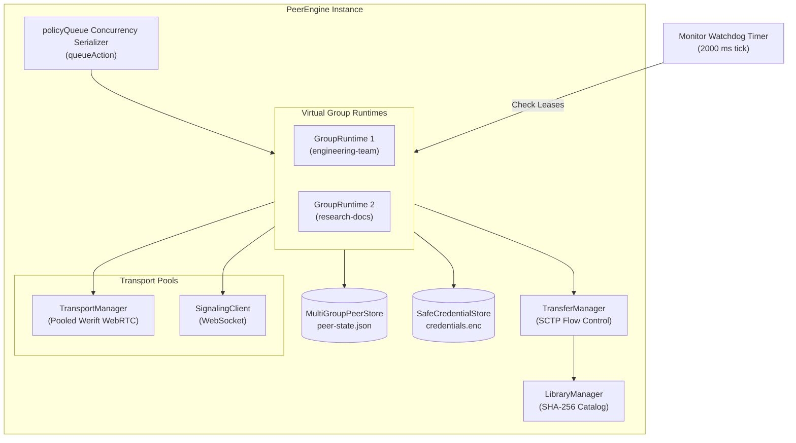

# Architecture: PeerEngine Lifecycle & State Management

This document details the internal lifecycle state machines, the `GroupRuntime` data structure, queue-based concurrency management, and throttled state dispatching implemented in `src/main/p2p/engine.ts`.

---

## 1. The `PeerEngine` Architecture

The `PeerEngine` is the central coordinator of the P2P subsystem in the Electron main process. It manages:
- **Virtual Group Runtimes** (`Map<GroupKey, GroupRuntime>`)
- **Shared Transport Associations** (`Map<SignalingUrl, TransportManager>`)
- **Signaling Clients** (`Map<SignalingUrl, SignalingClient>`)
- **Local File Library & SHA-256 Hashing Pipeline** (`LibraryManager`)
- **Active & Historical Transfers** (`TransferManager`)
- **Persistent State & Encrypted Keychains** (`MultiGroupPeerStore`, `SafeCredentialStore`)



---

## 2. The `GroupRuntime` Data Structure

Every joined or saved virtual group is managed by a dedicated in-memory `GroupRuntime` instance:

```typescript
interface GroupRuntime {
  groupKey: GroupKey                                // JSON string [signalingUrl, groupId]
  groupId: string                                  // Room identifier
  signalingUrl: string                             // WebSocket signaling URL
  autoJoin: boolean                                // Re-join on app launch
  supernodeEligible: boolean                       // Eligible for election
  credentialStatus: 'memory' | 'stored' | 'required'
  status: 'disconnected' | 'connecting' | 'connected' | 'degraded' | 'recovering' | 'error'
  role: 'supernode' | 'ordinary'
  epoch: string | null                             // Signaling server session UUID
  membershipRevision: number                       // Monotonic roster revision counter
  membershipId: string | null                      // Peer-group membership ID
  primaryPeerId: string | null                     // HRW Primary Supernode
  standbyPeerId: string | null                     // HRW Standby Supernode
  message: string
  members: SignalingRosterPeer[]                   // Active group roster
  activeElectedSupernodes: string[]                // Current elected supernodes
  lossDetectedTimestamp: number | null
  supernodeIndex: SupernodeIndexManager            // In-memory inverted search index
  searchResults: SearchResultsTracker              // Incoming search response aggregator
  recoveryRing: RecoveryEventRingBuffer            // Ring buffer of last 100 failovers
  searchQueryId: string | null
  searchQueryText: string
  searchStatus: 'idle' | 'searching' | 'complete' | 'partial' | 'error'
  searchMessage: string | null
  advertisedGeneration: number                     // Monotonic catalog generation counter
  acknowledgedGeneration: number | null
  lastRosterRenewedAt: number                      // Timestamp of last valid roster lease
  isJoined: boolean                                // Currently handshaked with signaling
}
```

---

## 3. Concurrency Serialization (`policyQueue`)

State modifications in a distributed system cannot execute arbitrarily out of order. If a user rapidly clicks "Join Group", "Leave Group", and "Toggle Privacy Mode", concurrent promises could interleave socket setup and teardown, leaving lingering sockets or orphaned WebRTC channels.

To eliminate race conditions without complex distributed locks, all group lifecycle mutations are serialized through a single internal promise chain called `policyQueue`:

```typescript
let policyQueue: Promise<void> = Promise.resolve()

function queueAction<T>(action: () => Promise<T>): Promise<T> {
  const enqueued = policyQueue.then(() => {
    if (isDisposed) {
      return Promise.reject(new Error('Engine disposed'))
    }
    return action()
  })
  // Catch rejections so subsequent actions in the queue are not blocked
  policyQueue = enqueued.then(
    () => {},
    () => {}
  )
  return enqueued
}
```

### Serialized Operations
The following operations must pass through `queueAction`:
1. `joinGroup`: Validates invitation, persists group, connects signaling client, handshakes group.
2. `resumeGroup`: Reconnects a previously saved group using remembered credentials.
3. `leaveGroup`: Gracefully unregisters from signaling, tears down group SCTP streams.
4. `forgetGroup`: Leaves group, permanently purges credentials, and atomically revokes all file grants.
5. `disconnectAll`: Disconnects all active groups.
6. `setRelayOnly`: Changes the ICE transport policy (enforces that all groups are disconnected first).

---

## 4. Freshness Lease Watchdog & Recovery Loop

The engine executes an active monitoring timer every $\tau_{\text{hb}} = 2000\text{ ms}$:

```typescript
const monitorTimer = setInterval(() => {
  if (isDisposed) return
  const now = Date.now()

  for (const runtime of groups.values()) {
    if (!runtime.isJoined) continue

    // Check Roster Freshness Lease (6000 ms)
    if (!hasFreshGroupAuthority(runtime)) {
      expireGroupAuthority(runtime)
    }

    // Check Supernode Heartbeat Health
    if (runtime.role === 'ordinary' && runtime.primaryPeerId) {
      const transport = endpointTransports.get(runtime.signalingUrl)
      const link = transport?.getLinkState(runtime.primaryPeerId)
      if (link && link.state !== 'open') {
        promoteStandbySupernode(runtime, 'Link down to primary supernode')
      }
    }
  }
  publishState()
}, 2000)
```

If the signaling link drops or heartbeat responses cease, `expireGroupAuthority` halts active transfers and resets the group's index before state inconsistency can propagate.

---

## 5. Throttled State Dispatching

The engine maintains a subscriber pattern to update external consumers (such as the Electron UI window). When multiple chunks arrive in a single second, notifying the UI on every chunk would choke Chromium's rendering thread.

`PeerEngine` coalesces updates using a $200\text{ ms}$ trailing debounce window:
1. When state changes, `publishState()` marks a dirty snapshot.
2. If `stateThrottleTimer` is active, the notification is deferred.
3. Once the $200\text{ ms}$ timer expires, the latest combined snapshot (`MultiGroupP2pState & P2pState`) is pushed via `IPC_CHANNELS.P2P_V2_STATE` and the legacy `P2P_STATE` channel simultaneously.
