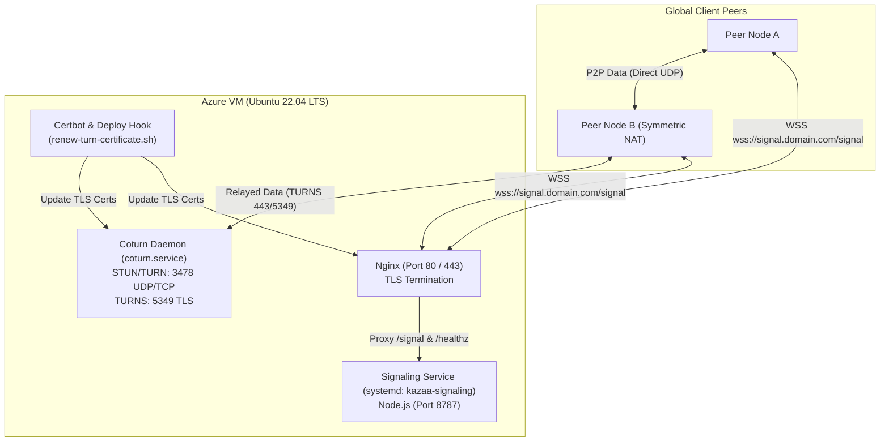

# Operations: Cloud Deployment & Infrastructure

This guide details deploying the authoritative signaling server and a dedicated Coturn STUN/TURN media relay across production cloud infrastructure (Azure Virtual Machines or Render.com PaaS).

---

## 1. Cloud Infrastructure Architecture

In production, client nodes are distributed globally behind heterogeneous NATs and firewalls. Reliable peer-to-peer connectivity requires:
1. **Signaling Server**: Handles WebSocket client connections over HTTPS/WSS (`443`).
2. **Coturn TURN/STUN Relay**: Traverses symmetric NATs via UDP/TCP (`3478`) and encrypted TLS TURNS (`5349` or `443`).
3. **Nginx Reverse Proxy**: Terminates TLS for HTTP health checks (`/healthz`) and proxies WebSocket upgrades (`/signal`).
4. **Certbot**: Issues and automatically renews Let's Encrypt certificates.



---

## 2. Production Azure VM Deployment (Ubuntu 22.04 LTS)

### Step 1: Provisioning & System Preparation
1. Create a Standard B1s or B2s Azure VM running Ubuntu 22.04 LTS.
2. Assign a static public IP and point your DNS FQDN (e.g. `signal.yourdomain.com`) to the IP.
3. Create the dedicated non-root service user:
   ```bash
   sudo useradd -r -m -d /home/kazaa -s /bin/bash kazaa
   sudo usermod -aG coturn kazaa
   ```

### Step 2: Install Node.js 24 and Coturn
```bash
# Install Coturn, Nginx, and Certbot
sudo apt-get update
sudo apt-get install -y coturn nginx certbot python3-certbot-nginx

# Install Node.js 24 LTS
curl -fsSL https://deb.nodesource.com/setup_24.x | sudo -E bash -
sudo apt-get install -y nodejs
```

### Step 3: Configure Coturn (`/etc/turnserver.conf`)
Edit `/etc/turnserver.conf`:
```ini
listening-port=3478
tls-listening-port=5349
fingerprint
lt-cred-mech
use-auth-secret
static-auth-secret=YOUR_COTURN_SHARED_SECRET_HEX_HERE
realm=signal.yourdomain.com
cert=/etc/coturn/certs/turn_server_cert.pem
pkey=/etc/coturn/certs/turn_server_pkey.pem
no-cli
no-loopback-peers
no-multicast-peers
min-port=49152
max-port=65535
```
Enable the daemon in `/etc/default/coturn`:
```ini
TURNSERVER_ENABLED=1
```

### Step 4: Configure the Signaling Service Unit
The repository includes a hardened systemd service unit template at `ops/azure/kazaa-signaling.service`:

```ini
[Unit]
Description=p2p-multiple-groups Authenticated Signaling Service
After=network.target

[Service]
Type=simple
User=kazaa
Group=kazaa
WorkingDirectory=/home/kazaa/app
ExecStart=/usr/bin/node services/signaling/index.ts
EnvironmentFile=/etc/kazaa/signaling.env

# Restart policy
Restart=on-failure
RestartSec=5s

# Security hardening
NoNewPrivileges=true
ProtectSystem=strict
ProtectHome=read-only
PrivateTmp=true
ProtectKernelTunables=true
ProtectKernelModules=true
ProtectControlGroups=true
RestrictRealtime=true
RestrictNamespaces=true
CapabilityBoundingSet=
LimitNOFILE=65536

[Install]
WantedBy=multi-user.target
```

Deploy the unit and environment file:
```bash
sudo cp ops/azure/kazaa-signaling.service /etc/systemd/system/kazaa-signaling.service

# Create protected environment file (mode 0600)
sudo mkdir -p /etc/kazaa
sudo tee /etc/kazaa/signaling.env > /dev/null <<EOF
P2P_MULTIPLE_GROUPS_SIGNAL_HOST=127.0.0.1
P2P_MULTIPLE_GROUPS_SIGNAL_PORT=8787
P2P_MULTIPLE_GROUPS_PUBLIC_SIGNAL_URL=wss://signal.yourdomain.com/signal
P2P_MULTIPLE_GROUPS_GROUPS_JSON=[{"groupId":"engineering-team","token":"$(openssl rand -hex 32)"},{"groupId":"research-docs","token":"$(openssl rand -hex 32)"}]
P2P_MULTIPLE_GROUPS_STUN_URL=stun:signal.yourdomain.com:3478
P2P_MULTIPLE_GROUPS_TURN_HOST=signal.yourdomain.com:3478
P2P_MULTIPLE_GROUPS_TURN_SECRET=YOUR_COTURN_SHARED_SECRET_HEX_HERE
EOF

sudo chmod 0600 /etc/kazaa/signaling.env
sudo chown root:root /etc/kazaa/signaling.env
```

### Step 5: Configure Nginx TLS Reverse Proxy
Create `/etc/nginx/sites-available/signaling`:
```nginx
server {
    server_name signal.yourdomain.com;

    location /healthz {
        proxy_pass http://127.0.0.1:8787/healthz;
        proxy_set_header Host $host;
    }

    location /signal {
        proxy_pass http://127.0.0.1:8787/signal;
        proxy_http_version 1.1;
        proxy_set_header Upgrade $http_upgrade;
        proxy_set_header Connection "upgrade";
        proxy_set_header Host $host;
        proxy_set_header X-Forwarded-For $remote_addr;
        proxy_read_timeout 86400s;
        proxy_send_timeout 86400s;
    }
}
```
Enable the site and obtain Let's Encrypt certificates:
```bash
sudo ln -s /etc/nginx/sites-available/signaling /etc/nginx/sites-enabled/
sudo certbot --nginx -d signal.yourdomain.com
```

### Step 6: Automated Certificate Hook (`ops/azure/renew-turn-certificate.sh`)
Install the renewal hook so Coturn receives renewed TLS certificates automatically without permission conflicts:
```bash
sudo cp ops/azure/renew-turn-certificate.sh /etc/letsencrypt/renewal-hooks/deploy/p2p-renew.sh
sudo chmod +x /etc/letsencrypt/renewal-hooks/deploy/p2p-renew.sh
sudo /etc/letsencrypt/renewal-hooks/deploy/p2p-renew.sh
```

### Step 7: Azure Network Security Group (NSG) Rules

Open the following ports on your Azure Network Security Group and host UFW:

| Port Range | Protocol | Source | Service |
|---|---|---|---|
| `80` | TCP | `*` | HTTP (Certbot ACME challenge) |
| `443` | TCP | `*` | HTTPS / WSS (Nginx proxy) |
| `3478` | UDP, TCP | `*` | Coturn STUN/TURN listener |
| `5349` | TCP | `*` | Coturn TURNS listener |
| `49152:65535` | UDP | `*` | Coturn Relay UDP Port Range |

Start and enable all services:
```bash
sudo systemctl daemon-reload
sudo systemctl enable --now coturn
sudo systemctl enable --now kazaa-signaling
sudo systemctl restart nginx
```

---

## 3. Turnkey PaaS Deployment (Render.com)

For lightweight deployments without managing virtual machines, the repository includes a ready-to-use **Render Blueprint** in `render.yaml`.

### Render Blueprint Deployment
1. Connect your GitHub repository to [Render.com](https://render.com).
2. Choose **New > Blueprint** and select the repository.
3. Render parses `render.yaml` and provisions:
   - Service Type: `web`
   - Node Version: `24.12.0`
   - Build Command: `npm ci --omit=dev`
   - Start Command: `npm run signal:start`
   - Health Check Path: `/healthz`
4. Set the secret environment variables in the Render dashboard:
   - `P2P_MULTIPLE_GROUPS_GROUPS_JSON`: Your group definitions JSON.
   - `P2P_MULTIPLE_GROUPS_PUBLIC_SIGNAL_URL`: `wss://your-render-app.onrender.com/signal`.
   - `P2P_MULTIPLE_GROUPS_STUN_URL`: `stun:stun.relay.metered.ca:80`.
   - `P2P_MULTIPLE_GROUPS_TURN_URL`: `turns:global.relay.metered.ca:443?transport=tcp`.
   - `P2P_MULTIPLE_GROUPS_TURN_USERNAME`: Metered.ca API username.
   - `P2P_MULTIPLE_GROUPS_TURN_CREDENTIAL`: Metered.ca API credential.

Render automatically provides free TLS termination, WebSocket connection upgrades, and continuous deployment on push.
