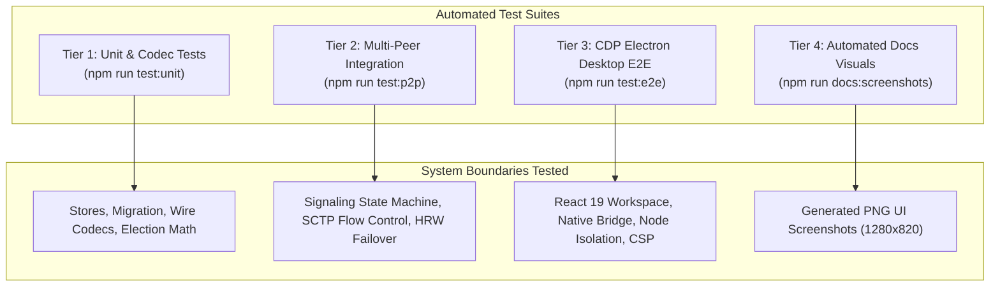

# Operations: Testing & Verification

This document details the multi-tiered verification harness of **`p2p-multiple-groups`**, execution instructions across test tiers, and regression testing checklists.

---

## 1. Test Architecture Overview

The verification harness uses Node.js native test runner (`node:test`) and the Chrome DevTools Protocol (CDP) to validate system invariants from micro-units up to end-to-end desktop execution.



---

## 2. Test Execution Tiers

### Tier 1: Unit & Wire Protocol Suites
Tests local storage invariants, schema migrations, wire protocol type guards, configuration parsing, and hardware credential store mocks.

```bash
npm run test:unit
```

**Coverage Breakdown**:
- `tests/theme-store.test.ts`: Theme persistence, fallback to system preference, JSON atomic write.
- `tests/credential-store.test.ts`: Queue serialization, `0o600` permissions, hardware keychain availability probe, in-memory fallback.
- `tests/peer-store-v2.test.ts`: V2 multi-group schema validation, concurrent writes, atomic rename, group revocation cascades.
- `tests/profile-migration.test.ts`: Idempotent V1 -> V2 profile migration, automatic backup creation (`peer-state.v1.backup.json`).
- `tests/signaling-config.test.ts`: Environment variable parsing, JSON group validation, STUN/TURN parameter checks.
- `tests/p2p-protocol.test.ts`: Wire protocol type guards, message boundary assertions, channel label formatting (`makeFileChannelLabelV2`).

---

### Tier 2: Multi-Peer Integration & Security Suites
Spawns in-memory signaling servers and multiple headless `PeerEngine` instances to test distributed systems logic over real WebSocket and WebRTC connections.

```bash
npm run test:p2p
```

**Coverage Breakdown**:
- `tests/signaling-server.test.ts`: Multi-group authentication, token verification in constant time, ephemeral HMAC-SHA1 TURN tokens, `GET /healthz`.
- `tests/signaling-client.test.ts`: Automatic reconnect, monotonic sequence checking (`epoch`, `revision`), roster lease renewal.
- `tests/p2p-integration.test.ts`: Supernode election, Highest Random Weight (HRW) assignment, ordinary leaf query routing.
- `tests/p2p-library-search.test.ts`: Background SHA-256 hashing pipeline, inverted catalog sync, boolean AND search.
- `tests/p2p-transfers.test.ts`: Chunked $16\text{ KiB}$ binary transfer, $256\text{ KiB}$ cumulative window ACKs, $512\text{ KiB}$ inflight window caps, buffer backpressure watermarks.
- `tests/p2p-transfers-survival.test.ts`: Transfer stall timeout recovery, atomic temporary file staging, mid-stream cancellation.
- `tests/p2p-multi-group.test.ts`: Multi-group multiplexing over pooled WebRTC SCTP associations.
- `tests/p2p-group-security.test.ts`: Zero cross-group leakage, dynamic grant revocation aborting active streams, constant-time token verification.
- `tests/p2p-engine-lifecycle.test.ts`: `policyQueue` concurrency serialization, `GroupRuntime` freshness lease expiration ($\tau_{\text{lease}} = 6000\text{ ms}$).

---

### Tier 3: Chrome DevTools Protocol (CDP) Desktop E2E
Spawns the packaged Electron application binary, establishes a CDP WebSocket connection, and drives the real Chromium renderer window.

```bash
npm run test:e2e
```

**Coverage Breakdown**:
- `tests/electron-e2e.test.ts`:
  - Verifies production Content Security Policy (`connect-src 'none'`).
  - Asserts strict Node.js isolation (`window.process`, `window.require`, and `window.Buffer` are `undefined`).
  - Verifies `window.p2p` and `window.kazaa` desktop bridge contracts.
  - Full keyboard navigation rail testing across all 6 views with focus verification.
  - Command palette interaction (`Ctrl+K` / `Cmd+K`).
  - Minimum viewport layout verification ($760 \times 520$) confirming zero horizontal overflow.
  - Multi-process end-to-end download flow with group badge rendering in the Transfers history table.

---

### Tier 4: Automated Documentation Visual Capture
Launches Electron with a pre-seeded multi-group state and headless peer, navigating through views and capturing verified production PNG screenshots to `docs/assets/`.

```bash
npm run docs:screenshots
```

---

## 3. Comprehensive Regression Checklist

Before submitting pull requests or cutting releases, execute the full validation pipeline:

```bash
# 1. Typecheck Node and Web codebases
npm run typecheck

# 2. Build production assets
npm run build

# 3. Run complete automated test suite
npm test

# 4. Refresh and verify visual documentation screenshots
npm run docs:screenshots
```

### Verification Matrix

| Check | Command | Pass Criteria |
|---|---|---|
| Node.js Typecheck | `npm run typecheck:node` | Exit code 0, 0 diagnostic errors |
| Web React Typecheck | `npm run typecheck:web` | Exit code 0, 0 diagnostic errors |
| Electron Vite Build | `npm run build` | All 3 targets (`main`, `preload`, `renderer`) compiled |
| Unit Tests | `npm run test:unit` | All tests pass |
| Integration Tests | `npm run test:p2p` | All tests pass |
| Desktop E2E Tests | `npm run test:e2e` | All tests pass |
| Documentation Visuals | `npm run docs:screenshots` | 6 screenshots generated in `docs/assets/` |
