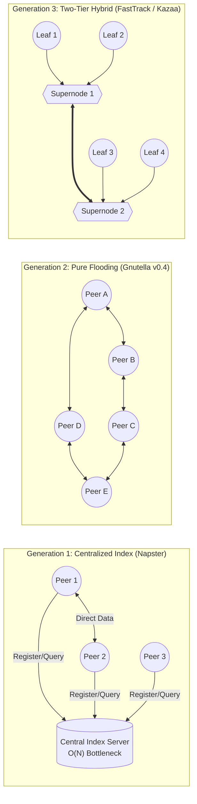

# Theory: Distributed Topology Foundations

This document details the architectural evolution of Peer-to-Peer (P2P) topologies, formalizes the scalability constraints that motivated two-tier hybrid networks, and compares **`p2p-multiple-groups`** against classical distributed systems.

---

## 1. Evolution of Peer-to-Peer Architectures

Distributed networks balance decentralization, routing efficiency, and bandwidth utilization. Historical architectures highlight distinct tradeoffs:

### Generation 1: Centralized Index (Napster, 1999)
- **Mechanics**: Peers connected to a centralized cluster of servers to upload their file catalogs and search for files. File transfer was direct peer-to-peer.
- **Complexity**: Search query lookup took $O(1)$ operations on the index server.
- **Failure Mode**: The central index represents a single point of failure (SPOF) and an operational bottleneck scaling as $O(N)$ with total peers $N$. It is also vulnerable to legal and infrastructural shutdown.

### Generation 2: Pure Unstructured Flooding (Gnutella v0.4, 2000)
- **Mechanics**: Fully decentralized overlay with no hierarchy. Queries were propagated using Breadth-First Search (BFS) flooding bounded by a Time-To-Live ($\text{TTL}$) counter.
- **Complexity**: For average node degree $d$ and hop count $\text{TTL}$, a single query generated:
  $$M_{\text{flood}} = \sum_{i=1}^{\text{TTL}} d \cdot (d - 1)^{i-1} = O(d^{\text{TTL}})$$
- **Failure Mode**: Network saturation and "query storms." As network size $N$ grew, the total query message volume across the network grew as $O(N \cdot d^{\text{TTL}})$. Slower modem and dial-up connections collapsed under upstream routing overhead, fragmenting the network.

### Generation 3: Two-Tier Hybrid Overlay (FastTrack / Kazaa, 2001)
- **Mechanics**: Recognized asymmetric edge node heterogeneity. Nodes with broadband connections, open NATs, and high CPU availability were dynamically designated as **Supernodes** ($S \ll N$).
- **Complexity**: Leaf nodes ($L = N - S$) connect to a single supernode, offloading their catalogs. Queries propagate only across the supernode mesh.

---

## 2. Mathematical Scalability Justification

Consider a network with $N$ total participating peers.

### Query Complexity in Flooded Overlays
In an unstructured flat network, searching for rare content requires traversing a substantial fraction of the network:
$$\text{Cost}_{\text{flat}} = O(N)$$
Each node must inspect and forward incoming query messages, consuming upstream network bandwidth proportionally to the total query rate across the entire global population:
$$\text{Upstream Bandwidth per Node} \propto \lambda_{\text{global}} \cdot \text{Cost}_{\text{flat}}$$
where $\lambda_{\text{global}}$ is the aggregate query generation frequency.

### Query Complexity in Two-Tier Supernode Overlays
In `p2p-multiple-groups`, the population is partitioned into supernodes $S$ and leaf nodes $L$, where typically:
$$|S| = \min(k, |\{p \in \text{Roster} \mid p.\text{supernodeEligible} = \text{true}\}|)$$
For virtual groups, $k = 2$ guarantees a **Primary Supernode** and a **Standby Supernode** per group.

Let $N_g$ be the number of peers in virtual group $g$.
1. **Catalog Offloading**: Leaf node $p$ publishes its catalog to its designated primary supernode in a single batched transmission:
   $$\text{Messages}_{\text{pub}} = O(1)$$
2. **Search Query Routing**: When leaf node $p$ initiates a search, it transmits the query solely to its assigned primary supernode:
   $$\text{Messages}_{\text{query}} = 1 = O(1)$$
3. **Index Evaluation**: The primary supernode executes a local memory lookup over its aggregated inverted index:
   $$\text{Lookup Time} = O(\text{tokens})$$
4. **Bandwidth Shielding**: Leaf nodes experience **zero** upstream bandwidth consumption from queries generated by other peers. Bandwidth consumption on leaf nodes is restricted purely to active file transfers.

Thus, the two-tier hybrid overlay reduces query forwarding overhead on $99\%$ of nodes from $O(N)$ to strictly $O(0)$, while keeping query latency bounded by a single round-trip time ($\text{RTT}$) between leaf and supernode.

---

## 3. Comparative Architecture Matrix

The following matrix compares `p2p-multiple-groups` with landmark distributed architectures:

| Architectural Dimension | Napster | Gnutella v0.4 | BitTorrent (Mainline DHT) | `p2p-multiple-groups` (This Project) |
|---|---|---|---|---|
| **Topology Type** | Centralized Index / P2P Transfer | Flat Unstructured P2P | Structured DHT (Kademlia) | Two-Tier Hybrid Overlay + Virtual Overlays |
| **Indexing Structure** | Central Relational DB | Distributed Flooding Cache | Distributed Hash Table ($b$-bit XOR metric) | Inverted Index per Virtual Group Supernode |
| **Search Query Cost** | $O(1)$ server request | $O(d^{\text{TTL}})$ broadcast | $O(\log N)$ exact key lookup | $O(1)$ supernode direct query |
| **Arbitrary Keyword Search** | Full substring / keyword | Full substring / keyword | Key-only (SHA-1 infohash); no arbitrary substring | Full tokenized boolean AND search |
| **Node Heterogeneity** | Homogeneous assumption | Homogeneous assumption | Homogeneous assumption | Asymmetric capability tiers (Supernode vs Leaf) |
| **NAT Traversal** | Outbound TCP client-to-host | Direct TCP; reverse connection for passive | STUN / uTP UDP hole punching | ICE (RFC 8445), STUN, Coturn TURN (RFC 5766) |
| **Transport Protocol** | TCP sockets | TCP sockets | TCP (v0) / uTP UDP | Werift Pure Node.js WebRTC (DTLS 1.2, SCTP) |
| **Multi-Tenancy** | Single global namespace | Single global overlay | Single swarm per torrent | Multiplexed virtual groups over shared SCTP |
| **Security & Auth** | Cleartext password | None (open network) | None (public torrent swarms) | Per-group cryptographic tokens, constant-time auth |
| **Credential Storage** | Plaintext config files | N/A | N/A | OS Keychains (DPAPI, macOS Keychain, Secret Service) |
