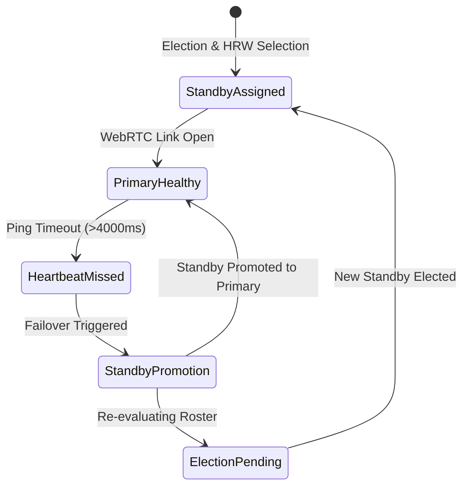

# Theory: Supernode Election & Consistent Hashing

This document details the deterministic election mechanics and Rendezvous (Highest Random Weight) consistent hashing algorithms implemented in `src/main/p2p/election.ts`.

---

## 1. Supernode Election Algorithm

Within every virtual group, nodes dynamically elect supernodes from the set of active group participants. The election algorithm is **deterministic**, **stateless**, and guarantees identical results across all peers without requiring Byzantine agreement rounds or distributed leader leases.

### Candidate Eligibility Predicate
Let $\mathcal{R}$ be the current authoritative roster received from the signaling server for virtual group $G$:
$$\mathcal{C} = \{ p \in \mathcal{R} \mid p.\text{supernodeEligible} = \text{true} \}$$
Peers mark themselves eligible via the `supernodeEligible` boolean flag in their local network configuration.

### Strict Total Ordering
To eliminate split-brain ambiguities and race conditions, candidate set $\mathcal{C}$ is sorted according to a strict total ordering relation $\prec$:

$$a \prec b \iff (a.\text{joinOrder} < b.\text{joinOrder}) \lor (a.\text{joinOrder} = b.\text{joinOrder} \land a.\text{peerId} <_{\text{lex}} b.\text{peerId})$$

- `joinOrder`: A monotonically increasing integer assigned by the authoritative signaling server when the peer handshakes into the group.
- `peerId`: Lexicographical tie-breaker using RFC 4122 UUID strings.

### Top-$k$ Selection
Let $\text{sort}_{\prec}(\mathcal{C}) = [c_1, c_2, \dots, c_m]$. The elected supernode set $\mathcal{S}$ is:
$$\mathcal{S} = \{ c_i \mid i \le \min(k, m) \}$$
In `p2p-multiple-groups`, $k = 2$.
- If $m \ge 2$: The top 2 nodes are designated as elected supernodes.
- If $m = 1$: Exactly 1 supernode is elected; standby is null.
- If $m = 0$: No supernodes are available; the network operates in a fallback ad-hoc mode.

```typescript
// Verified implementation from src/main/p2p/election.ts
export function electSupernodes(peers: readonly SignalingRosterPeer[]): ElectionResult {
  const eligible = peers.filter((p) => p.supernodeEligible)
  eligible.sort((a, b) => {
    if (a.joinOrder !== b.joinOrder) {
      return a.joinOrder - b.joinOrder
    }
    return a.peerId.localeCompare(b.peerId)
  })

  return {
    electedSupernodes: eligible.slice(0, 2),
    eligibleCandidates: eligible.slice(2)
  }
}
```

---

## 2. Rendezvous / Highest Random Weight (HRW) Hashing

Once supernodes $\mathcal{S}$ are elected, each ordinary peer $p \in \mathcal{R} \setminus \mathcal{S}$ must establish a primary connection to one supernode for catalog indexing and a standby connection for redundancy.

Rather than assigning nodes randomly (which creates hot spots) or using modulo hashing (which causes cascading reassignments under churn), the system uses **Rendezvous Hashing** (Thaler & Ravishankar, 1998).

### Hash Scoring Function
For peer $p$ and supernode $s \in \mathcal{S}$, the affinity score is defined as:

$$\text{Score}(p, s) = \text{SHA-256}(p.\text{peerId} \parallel \text{":"} \parallel s.\text{peerId})$$

where $\text{SHA-256}(\cdot)$ outputs a 256-bit hexadecimal string.

### Supernode Assignment
The peer selects its primary supernode $s_1$ and standby supernode $s_2$ by maximizing the score:

$$s_1 = \arg\max_{s \in \mathcal{S}} \text{Score}(p, s)$$
$$s_2 = \arg\max_{s \in \mathcal{S} \setminus \{s_1\}} \text{Score}(p, s)$$

Ties in hash value are broken by reverse lexicographical comparison of the supernode IDs:
```typescript
// Verified implementation from src/main/p2p/election.ts
scored.sort((a, b) => {
  if (a.hash !== b.hash) {
    return b.hash.localeCompare(a.hash)
  }
  return b.supernode.peerId.localeCompare(a.supernode.peerId)
})
```

---

## 3. Mathematical Proof of Churn Minimality

A critical problem in distributed hashing is **churn**: nodes departing and joining must not trigger a global migration of state.

### Modulo Hashing Vulnerability
Under classical modulo hashing:
$$h(p) = \text{hash}(p) \pmod{|\mathcal{S}|}$$
When $|\mathcal{S}|$ changes from $n$ to $n-1$, almost every peer's assigned supernode shifts:
$$\mathbb{P}(\text{reassignment}) = \frac{n-1}{n}$$
As $n$ grows, nearly $100\%$ of peers are reassigned, flooding the remaining supernodes with re-indexing catalog traffic.

### Highest Random Weight Churn Bound
In Rendezvous Hashing, the scores $\{\text{Score}(p, s) \mid s \in \mathcal{S}\}$ are independent and identically distributed (i.i.d.) random variables across the hash space.

**Theorem (Minimal Churn)**: When supernode $s^*$ departs from set $\mathcal{S}$ where $|\mathcal{S}| = n$:
1. A peer $p$ requires reassignment if and only if $s^*$ was its assigned supernode:
   $$\mathbb{P}(p \text{ was assigned to } s^*) = \frac{1}{n}$$
2. If $s^*$ was not assigned to $p$, $p$'s assignment remains unchanged:
   $$\mathbb{P}(p \text{ retains its assignment}) = 1 - \frac{1}{n} = \frac{n-1}{n}$$
3. When $s^*$ departs, only exactly $\frac{1}{n}$ of the total peer population shifts to a new supernode. The remaining $\frac{n-1}{n}$ fraction experiences zero catalog re-transmission.

$$\text{Reassignment Fraction} = \frac{1}{|\mathcal{S}|} \quad (\text{Strictly Minimal})$$

---

## 4. Standby Promotion & Failure Recovery

The dual-supernode topology ($k=2$) ensures that ordinary peers maintain warm failover readiness.



### Failover State Transition
1. **Normal Operation**:
   - Leaf publishes full catalog to Primary Supernode $s_1$.
   - Leaf maintains a pre-warmed signaling route or WebRTC control channel with Standby Supernode $s_2$.
2. **Primary Supernode Failure**:
   - If $s_1$ disconnects or fails to acknowledge catalog queries within the lease timeout:
   - The engine logs a `P2pRecoveryEvent` of type `failover`.
   - The leaf node immediately promotes $s_2$ to active query target.
   - The leaf transmits its batched catalog ($\le 32$ entries) to $s_2$.
3. **Standby Replacement**:
   - The signaling server detects $s_1$'s socket close and issues an updated roster with an incremented `membershipRevision`.
   - All nodes rerun `electSupernodes` and `selectSupernodesForPeer`.
   - The former standby $s_2$ is formally elected primary, and the next candidate in $\mathcal{C}$ becomes the new standby.
