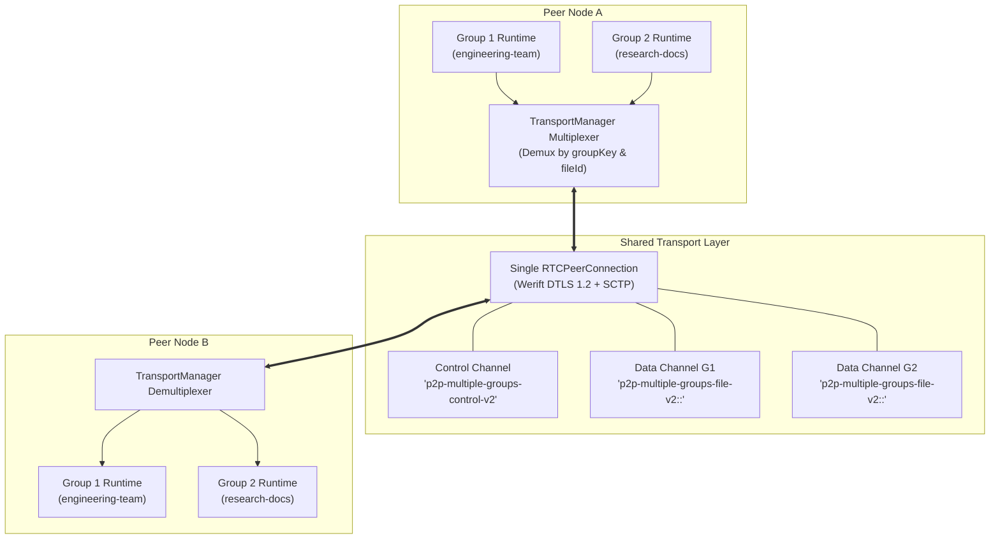

# Theory: Virtual Overlays & Authoritative Consensus

This document details the multi-group multiplexing architecture, authoritative signaling lease mechanics, and inverted index query routing implemented in `src/main/p2p/engine.ts` and `src/main/p2p/search-index.ts`.

---

## 1. Multi-Group Multiplexing Theory

In standard P2P implementations, participating in $M$ distinct networks requires establishing $M$ disjoint transport sessions, leading to exponential connection overhead and socket exhaustion.

### Mathematical Formulation
Let a virtual group $G$ be defined as a 2-tuple:
$$G = (\text{groupId}, \mathcal{K}_{\text{auth}})$$
where $\text{groupId} \in \Sigma^*$ is a valid room identifier and $\mathcal{K}_{\text{auth}}$ is a secret authorization token.

Let $\mathcal{P}_{A}$ and $\mathcal{P}_{B}$ be two peers participating in group sets $\mathcal{G}_A$ and $\mathcal{G}_B$ respectively.
If $\mathcal{G}_{AB} = \mathcal{G}_A \cap \mathcal{G}_B \neq \emptyset$, peers $A$ and $B$ share at least one mutual group.

### Single-Association Transport Pooling
Instead of establishing $|\mathcal{G}_{AB}|$ independent WebRTC peer connections between $A$ and $B$, the system pools all communication over a **single physical WebRTC association**:



### Protocol Isolation Guarantees
1. **Control Multiplexing**: Every control message across the shared `p2p-multiple-groups-control-v2` channel explicitly carries its destination `groupKey`. The engine routes payloads strictly to the matching local `GroupRuntime`.
2. **Channel Label Scoping**: File transfer data channels encode the group key directly into their protocol label:
   $$\text{Label} = \text{"p2p-multiple-groups-file-v2:"} \parallel \text{fileId} \parallel \text{":"} \parallel \text{groupKey}$$
3. **Zero Cross-Contamination**: If Peer $B$ attempts to request a file using $G_1$'s data channel while authenticated only for $G_2$, the request is rejected with `FORBIDDEN` and the channel is torn down without affecting $G_2$'s active streams.

---

## 2. Authoritative Membership & Renewable Leases

Decentralized overlays are prone to split-brain states and ghost peers when members abruptly disconnect without graceful teardown. `p2p-multiple-groups` addresses this using an authoritative signaling state machine combined with **Renewable Freshness Leases**.

### Sequence Numbers & Monotonic Revisions
For each virtual group $G$, the signaling server maintains:
- $\text{epoch} \in \text{UUIDv4}$: A unique identifier generated whenever the signaling server restarts.
- $\text{membershipRevision} \in \mathbb{N}$: A strictly monotonic integer counter incremented on every peer join or departure.

When a client receives a `roster` message:
$$\text{Reject} \iff (\text{roster}.\text{epoch} \neq \text{local}.\text{epoch}) \lor (\text{roster}.\text{rev} \le \text{local}.\text{rev})$$
This prevents out-of-order UDP or WebSocket deliveries from rolling back membership state.

### The Freshness Lease Invariant
To prevent peers from operating on obsolete or revoked authority, membership is bound to a strict time-based lease:

$$\tau_{\text{lease}} = 6000\text{ ms} \quad (\text{ROSTER\_FRESHNESS\_LEASE\_MS})$$
$$\tau_{\text{hb}} = 2000\text{ ms} \quad (\text{Heartbeat interval})$$

Let $t_{\text{last\_roster}}$ be the timestamp of the last valid roster message received from the signaling server. At any instant $t_{\text{now}}$:

$$\text{Group Authority Valid} \iff t_{\text{now}} - t_{\text{last\_roster}} \le \tau_{\text{lease}}$$

```typescript
// Verified implementation from src/main/p2p/engine.ts
function isGroupAuthorityValid(runtime: GroupRuntime): boolean {
  if (runtime.lastRosterRenewedAt <= 0) return false
  return Date.now() - runtime.lastRosterRenewedAt <= ROSTER_FRESHNESS_LEASE_MS
}
```

### Expiration Consequences
If network connectivity to the signaling server is interrupted for $> 6000\text{ ms}$:
1. The local `GroupRuntime` transitions to status `recovering`.
2. All active uploads and downloads negotiated under this group's authority are immediately halted.
3. Supernodes cease answering search queries for that group.
4. **Fault Boundary**: Other virtual groups on the same host with healthy signaling links continue normal operation without interruption.

---

## 3. Inverted Search Indexing & Query Routing

Supernodes maintain an in-memory inverted catalog index via `SupernodeIndexManager`.

### Catalog Publication Pipeline
When an ordinary peer joins or updates its library:
1. Dispatches `catalog-begin` with expected `count` and monotonic `generation`.
2. Staging buffer retains incoming batches ($\le 32$ entries per message).
3. Dispatches `catalog-end`. Upon receipt, the supernode atomically commits the staged entries into `ownerCatalogues`, evicting the previous generation for that peer.
4. A staging timeout ($\text{CATALOG\_STAGING\_TTL\_MS} = 5000\text{ ms}$) purges incomplete catalog streams.

### Query Normalization & Token Matching
Queries undergo deterministic canonicalization:
$$\text{Tokens} = \text{split}(\text{normalize}_{\text{NFKC}}(\text{lowercase}(\text{query})))$$
A file matches if and only if:
$$\forall \tau \in \text{Tokens}: \tau \subseteq \text{normalize}_{\text{NFKC}}(\text{lowercase}(\text{fileName}))$$

### Query Deduplication Cache
To prevent routing loops when queries are forwarded between primary and standby supernodes, supernodes maintain an LRU query deduplication cache:
- **Cache Key**: $\text{originPeerId} \parallel \text{":"} \parallel \text{queryId}$
- **Maximum Cache Size**: $256$ entries (`MAX_CACHED_QUERIES`)
- **Time-to-Live**: $30\text{ seconds}$ (`QUERY_CACHE_TTL_MS`)

If an incoming `search` or `search-forward` matches a valid cached entry, the message is dropped immediately, eliminating query echo loops.
