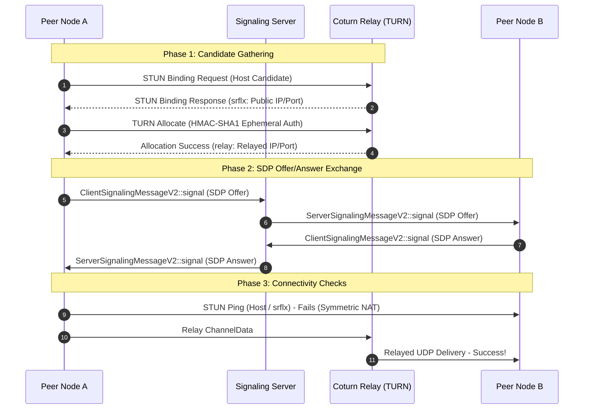

# Theory: NAT Traversal & WebRTC Architecture

This document details the Network Address Translation (NAT) traversal mechanics, Interactive Connectivity Establishment (ICE / RFC 8445), dynamic HMAC-SHA1 TURN authentication, and the Werift user-space WebRTC stack.

---

## 1. NAT Behavior & Traversal Fundamentals

Most edge nodes reside in private IPv4 subnets behind Network Address Translators (NAT). NAT devices rewrite source IP addresses and UDP/TCP port numbers on outbound packets, establishing stateful translation bindings.

### RFC 4787 / 3489 NAT Classifications

| NAT Type | Mapping Behavior | Filtering Behavior | Direct P2P Hole Punching |
|---|---|---|---|
| **Full Cone** | Same external $(IP_{ext}, Port_{ext})$ for all outbound destinations. | Any external host can send packets to $(IP_{ext}, Port_{ext})$. | **Trivial**: STUN discovery suffices. |
| **Address-Restricted** | Same external $(IP_{ext}, Port_{ext})$ for all outbound destinations. | External host can reply only if internal node previously sent packet to that host's IP. | **Feasible**: Simultaneous UDP hole punch. |
| **Port-Restricted** | Same external $(IP_{ext}, Port_{ext})$ for all outbound destinations. | External host can reply only if internal node previously sent packet to that host's $(IP, Port)$. | **Feasible**: Coordinated simultaneous hole punch. |
| **Symmetric NAT** | Allocates a **different** $(IP_{ext}, Port_{ext})$ for every distinct remote destination $(IP_{dest}, Port_{dest})$. | Only the exact destination socket can reply. | **Impossible between two Symmetric NATs without TURN relay**. |

### The Symmetric NAT Dilemma
When Peer $A$ behind a Symmetric NAT queries a public STUN server $S$, the NAT allocates mapping $M_1 = (IP_{ext}, Port_{1})$.
When Peer $A$ subsequently attempts to send packets to Peer $B$, the NAT dynamically allocates a brand new mapping $M_2 = (IP_{ext}, Port_{2})$.

Because $Port_2 \neq Port_1$ and port allocation algorithms vary (random, incremental, or hashed), Peer $B$ cannot predict $Port_2$. If Peer $B$ is also behind a Symmetric or Port-Restricted NAT, both firewalls drop all direct inbound hole-punch packets.

---

## 2. Interactive Connectivity Establishment (ICE - RFC 8445)

`p2p-multiple-groups` employs ICE to discover and negotiate the optimal network path between peers.



### ICE Candidate Types
1. **Host Candidates (`host`)**: Direct local network interfaces (e.g. `192.168.1.105` or local IPv6).
2. **Server Reflexive Candidates (`srflx`)**: External IP and port mapped by intermediate NATs, discovered via STUN.
3. **Relay Candidates (`relay`)**: Relayed endpoints provisioned on an external TURN server. Guarantees 100% connectivity regardless of symmetric NAT barriers.

---

## 3. Ephemeral HMAC-SHA1 TURN Authentication (RFC 5766)

Static TURN credentials create severe security vulnerabilities if distributed to untrusted peers. Instead, the signaling server dynamically issues **short-lived ephemeral TURN credentials** conforming to the TURN REST API standard.

### Algorithmic Formulation
When a peer handshakes with the signaling server:
1. The server sets an expiration timestamp:
   $$t_{\text{expiry}} = \lfloor \text{now} / 1000 \rfloor + 86400 \quad (24\text{ hours})$$
2. The username is derived from the expiration time and session ID:
   $$\text{Username} = t_{\text{expiry}} \parallel \text{":"} \parallel \text{sessionId}$$
3. The credential is computed via keyed HMAC-SHA1:
   $$\text{Credential} = \text{Base64}(\text{HMAC-SHA1}(K_{\text{turn\_secret}}, \text{Username}))$$

```typescript
// Verified implementation from services/signaling/server.ts
const expirySec = Math.floor(Date.now() / 1000) + 86400
const username = `${expirySec}:${sessionId}`
const hmac = createHmac('sha1', options.turnSecret)
hmac.update(username)
const credential = hmac.digest('base64')
```

4. The Coturn relay verifies incoming packets using the identical shared secret $K_{\text{turn\_secret}}$ without maintaining a shared database or state table. Expired usernames are rejected automatically.

---

## 4. The Werift WebRTC Stack

Unlike typical Electron applications that rely on Chromium's native C++ WebRTC bindings (which expose limited low-level control and introduce unpredictable native crashes), `p2p-multiple-groups` utilizes **Werift**:

- **Pure TypeScript / Node.js Runtime**: Implements WebRTC protocols entirely in managed code.
- **Protocol Subsystems**:
  - **DTLS 1.2**: Transport Layer Security handshake over UDP.
  - **SRTP**: Secure Real-time Transport Protocol encryption.
  - **SCTP (Stream Control Transmission Protocol)**: Reliable, sequenced message chunking and flow-controlled data channels.
- **Portability**: Operates seamlessly across Windows, macOS, and headless Linux without requiring native compilation toolchains or GPU access.

---

## 5. Privacy Invariants & Relay Enforcement (`relayOnly`)

When a user enables **Privacy Mode** (`relayOnly = true`):
1. The Werift connection configuration sets:
   $$\text{iceTransportPolicy} = \text{'relay'}$$
2. The ICE engine filters out all `host` and `srflx` candidates. Only `relay` candidates are emitted in SDP offers and answers.
3. **Formal Privacy Invariant**: A peer inspecting incoming ICE candidates can observe only the IP address of the Coturn relay server. The user's home ISP, public IP address, and local subnet geometry are mathematically shielded from other peers.
