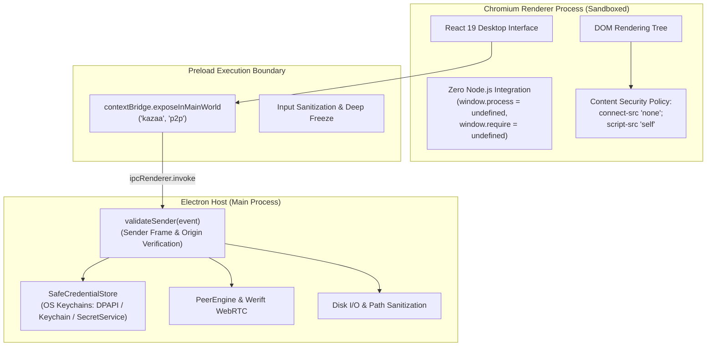

# Theory: Security Architecture & Threat Model

This document defines the formal threat model for **`p2p-multiple-groups`**, outlines cryptographic security invariants, and analyzes defense-in-depth mechanisms guarding against network adversaries, malicious peers, and local host exploits.

---

## 1. Threat Model & Adversary Capabilities

The system assumes a zero-trust model across the peer overlay:

| Adversary Persona | Assumed Capabilities | Out of Scope / Non-Goals |
|---|---|---|
| **Eavesdropping Network Adversary** | Can observe, intercept, and modify raw UDP/TCP transit packets; operates malicious intermediary NAT/routers. | Physical extraction of host device hardware secrets. |
| **Rogue Group Member** | Legitimate participant in Virtual Group $A$; attempts to discover or download files from Virtual Group $B$ without credentials. | Compromise of peer host OS kernel or supervisor privileges. |
| **Malicious Signaling Host** | Controls the signaling WebSocket server; attempts to read file transfers, forge peer identities, or spoof catalogs. | Signaling host is trusted only for peer discovery and roster ordering, **never** for transfer contents. |
| **Malicious Content Provider** | Advertises valid metadata/hash for popular files but streams corrupted or trojaned bytes during download. | Post-download execution analysis (antivirus scanning). |

---

## 2. Cryptographic Isolation Guarantees

### Independent Group Token Boundaries
Each virtual group requires a distinct cryptographic secret:
$$G_i = (\text{groupId}_i, \mathcal{K}_i)$$
Tokens $\mathcal{K}_i$ and $\mathcal{K}_j$ ($i \neq j$) are mathematically uncorrelated.
- Possession of $\mathcal{K}_i$ grants access strictly to group $G_i$'s control channels and file catalogs.
- A peer sharing a physical WebRTC SCTP association across multiple groups cannot infer catalog contents or initiate downloads in groups for which it lacks a valid token.

### Constant-Time Token Verification
To defend against **timing side-channel attacks** where an attacker measures string comparison microsecond deltas to reconstruct secret tokens byte-by-byte, token checks employ constant-time comparison primitives:

```typescript
// Verified implementation pattern from services/signaling/server.ts
function safeCompareTokens(a: string, b: string): boolean {
  const bufA = Buffer.from(a, 'utf-8')
  const bufB = Buffer.from(b, 'utf-8')
  if (bufA.length !== bufB.length) return false
  return timingSafeEqual(bufA, bufB)
}
```

$$\text{Time}(\text{compare}(a, b)) = \mathcal{O}(|a|) \quad \text{independent of matching prefix length}$$

### Dynamic Capability Grant Enforcement
File access grants are verified dynamically on **every single chunk dispatch**:
1. When an uploader prepares a $16\text{ KiB}$ binary chunk, it queries the local `LibraryManager`:
   ```typescript
   const isAuthorized = library.isGranted(fileId, groupKey)
   ```
2. If the user revokes the group's grant in the Library UI while a transfer is in progress, `isAuthorized` evaluates to `false` on the very next chunk dispatch.
3. The engine immediately sends `TransferControlMessageV2::error` with `FORBIDDEN` and resets the data channel.
4. **Leakage Prevention**: No further file bytes escape the host machine once a grant is revoked.

---

## 3. Sandboxing & Defense-in-Depth

Desktop applications built with web technologies require multi-layered sandboxing to prevent Cross-Site Scripting (XSS) or untrusted network input from escalating into arbitrary code execution.



### 1. Strict Content Security Policy (CSP)
The production HTML document enforces a locked-down CSP:
```html
<meta http-equiv="Content-Security-Policy" content="default-src 'self'; script-src 'self'; style-src 'self' 'unsafe-inline'; img-src 'self' data:; connect-src 'none'; font-src 'self'; object-src 'none'; media-src 'none'; frame-src 'none';" />
```
- **`connect-src 'none'`**: The renderer process is mathematically barred from making HTTP, WebSocket, or WebRTC connections. Even if an attacker injects malicious JavaScript into the DOM, that script cannot establish outbound command-and-control network channels.
- **`object-src 'none'`**: Disables plugins (Java, Flash).
- **`frame-src 'none'`**: Disables iframe nesting.

### 2. Node.js Context Isolation
- `contextIsolation: true`
- `nodeIntegration: false`
- `sandbox: true`
The global renderer scope lacks access to `process`, `Buffer`, `require()`, or filesystem primitives (`tests/electron-e2e.test.ts` asserts these evaluate to `undefined`). Communication with native capabilities is strictly mediated by `window.p2p` via `contextBridge`.

### 3. IPC Sender Origin Validation
Every IPC handler in the main process verifies the caller's origin:
```typescript
function validateSender(event: IpcMainInvokeEvent): void {
  if (!mainWindow || mainWindow.isDestroyed()) throw new Error('Untrusted sender')
  if (event.sender !== mainWindow.webContents) throw new Error('Untrusted sender')
  const frame = event.senderFrame
  if (!frame || frame.parent !== null) throw new Error('Untrusted sender')

  if (isDev) {
    if (new URL(frame.url).origin !== expectedDevOrigin) throw new Error('Untrusted origin')
  } else {
    if (frame.url !== productionHtmlUrl) throw new Error('Untrusted origin')
  }
}
```
If an adversary spawns a child window or attempts cross-origin navigation, all IPC handlers immediately reject invocations.

### 4. Filesystem Path Traversal Defense
Inbound downloads sanitize remote filenames using `sanitizeDestinationFileName`:
- Strips null bytes (`\0`), path separators (`/`, `\`), and directory traversal markers (`..`).
- Removes trailing spaces and periods that cause filesystem truncation exploits on Windows.
- Defaults to `download` if sanitization empties the filename.

### 5. OS Keychain Hardware Protection
Group tokens and credentials are never stored in plaintext configuration files. They are encrypted using `safeStorage`:
- **Windows**: Encrypted with DPAPI using the logged-in Windows user's master key.
- **macOS**: Stored using Apple Keychain Services with application-scoped access controls.
- **Linux**: Stored using libsecret / Secret Service DBus daemon, preventing unauthorized processes from reading credential blobs.
