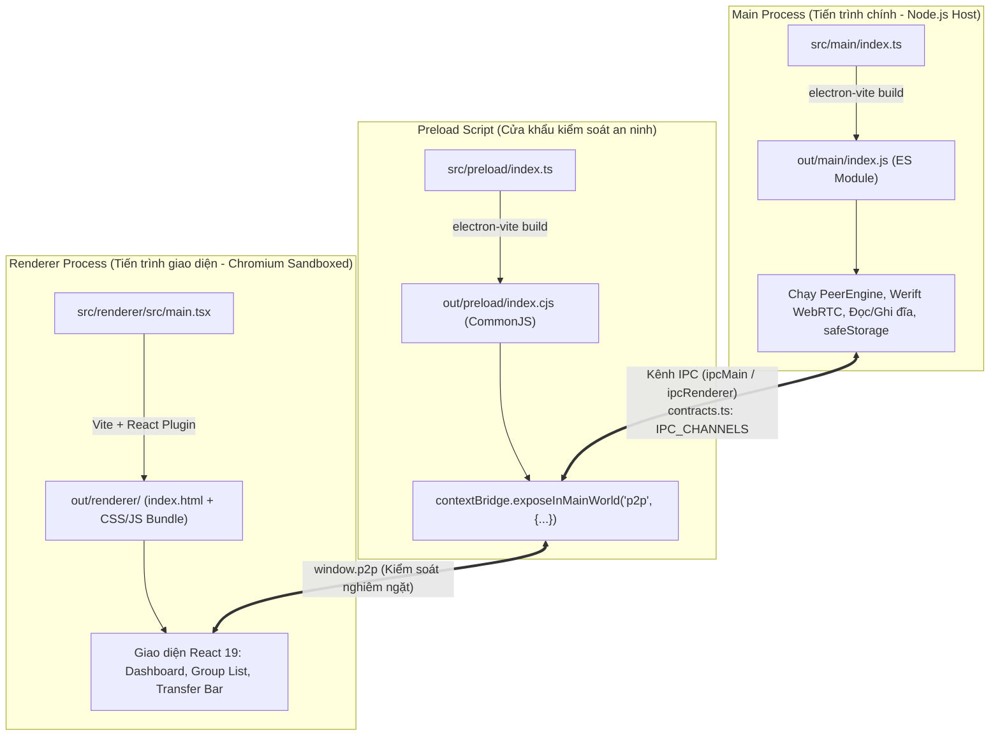

# Cẩm Nang Nền Tảng JS/TS, Node.js, npm & Toàn Bộ Lệnh CLI Trong Project

> **Dành cho ai?** Tài liệu này dành cho lập trình viên, kỹ sư mới làm quen với hệ sinh thái JavaScript (JS), TypeScript (TS), Node.js và `npm`, hoặc những ai muốn hiểu cặn kẽ bản chất từng câu lệnh, luồng biên dịch và cấu trúc vận hành bên dưới của dự án **`p2p-multiple-groups`**.

---

## Mục lục tra cứu nhanh

1. [Phần 1: Nền tảng cốt lõi — JS, TS, Node.js và npm liên kết với nhau thế nào?](#he-sinh-thai-js-ts-node-npm)
2. [Phần 2: Kiến trúc 3 tiến trình Electron và hệ thống 3 file tsconfig](#kien-truc-build-electron-vite)
3. [Phần 3: Bảng tra cứu nhanh toàn bộ 16 lệnh trong Project](#bang-tra-cuu-nhanh-cac-lenh)
4. [Phần 4: Giải thích chuyên sâu từng lệnh: Tại sao có, nó làm gì, cờ/tham số là gì?](#giai-thich-chi-tiet-tung-lenh)
5. [Phần 5: Các quy trình thực hành chuẩn cho người mới bắt đầu](#quy-trinh-thuc-te)

---

## <a id="he-sinh-thai-js-ts-node-npm"></a>1. Nền tảng cốt lõi — JS, TS, Node.js và npm

Nếu bạn xuất thân từ C++, C#, Java, Python hay Go, việc nhìn thấy hàng loạt file đuôi `.js`, `.ts`, `.tsx`, `.cjs`, file cấu hình `package.json`, `tsconfig.json` và thư mục `node_modules` có thể gây cảm giác ngợp. Dưới đây là bức tranh toàn cảnh giải thích chính xác từng khái niệm và cách chúng phối hợp cùng nhau.

### 1.1. JavaScript (JS): Ngôn ngữ thực thi chính

JavaScript là ngôn ngữ kịch bản (scripting language) chạy trong môi trường đơn luồng có cơ chế Event Loop bất đồng bộ (Non-blocking I/O). 

- **Nguyên lý quan trọng nhất**: **Cả trình duyệt Chromium (giao diện) lẫn môi trường Node.js (máy chủ/tiến trình nền) về bản chất đều chỉ trực tiếp hiểu và chạy mã JavaScript tiêu chuẩn.**
- Trong dự án này, mã nguồn JavaScript tuân theo chuẩn **ECMAScript Modules (ESM)** hiện đại: dùng từ khóa `import { foo } from './bar.js'` để nạp module và `export const bar = ...` để chia sẻ tài nguyên. Điều này được quy định bởi dòng `"type": "module"` trong file `package.json`.

### 1.2. TypeScript (TS & TSX): Lớp giáp bảo vệ và bản thiết kế kiểu dữ liệu

JavaScript thuần là ngôn ngữ định kiểu động (dynamically typed) — bạn có thể gán một biến từ chuỗi sang số nguyên, hoặc gọi một hàm mà không truyền đủ tham số, và lỗi chỉ phát nổ khi chương trình đang chạy thực tế (Runtime Error). Trong một hệ thống P2P phức tạp như `p2p-multiple-groups`, nơi các gói tin nhị phân WebRTC, dữ liệu mã hóa SHA-256 và trạng thái nhóm (`GroupRuntime`) chuyển đổi liên tục, việc gặp lỗi runtime sẽ làm sập kết nối của cả cụm ngang hàng.

**TypeScript ra đời để giải quyết vấn đề này**:
- TypeScript là JavaScript được gắn thêm **hệ thống kiểu tĩnh (Static Types)**.
- Ví dụ, trong file `src/shared/p2p.ts`, chúng ta định nghĩa kiểu `GroupInvitation`:
  ```typescript
  export interface GroupInvitation {
    version: 2
    groupId: string
    groupName: string
    signalingUrl: string
    token: string
    createdAt: number
    expiresAt?: number
  }
  ```
  Nếu bạn vô tình viết mã cố tình gửi lời mời thiếu trường `signalingUrl`, TypeScript sẽ lập tức gạch chân đỏ cảnh báo lỗi ngay lúc bạn gõ phím.
- **File `.tsx`**: Là file TypeScript có chứa cú pháp JSX (giao diện của React). Thay vì viết HTML trong một file riêng, React cho phép bạn viết các thẻ giao diện như `<button onClick={joinGroup}>Gia nhập</button>` trực tiếp trong mã TypeScript.

#### Cơ chế xử lý TypeScript trong dự án này (Điểm đặc biệt cần lưu ý!)

Thông thường, TypeScript phải được biên dịch (compile/transpile) thành JavaScript bằng lệnh `tsc` trước khi chạy. Tuy nhiên, trong dự án `p2p-multiple-groups`, có **2 cơ chế xử lý hoàn toàn tách biệt**:

1. **Kiểm tra lỗi tĩnh (Typechecking)**:
   - Được thực hiện bởi trình biên dịch TypeScript chuẩn (`tsc`) thông qua lệnh `npm run typecheck`.
   - Lệnh này sử dụng cờ `--noEmit` — tức là **chỉ đọc mã, kiểm tra tính đúng đắn của kiểu dữ liệu, nếu có lỗi thì báo cáo, tuyệt đối không tạo ra file mới nào trên ổ cứng**.

2. **Chuyển đổi để chạy thực tế (Runtime Execution)**:
   - **Đối với các file chạy độc lập (Node.js)** như test (`tests/*.test.ts`), máy chủ signaling (`services/signaling/index.ts`), hoặc script tiện ích (`scripts/*.ts`):
     Dự án yêu cầu **Node.js `>=24.12.0`**. Ở phiên bản này, Node.js đã tích hợp tính năng **Native Type Stripping** (Lột bỏ kiểu TypeScript tự nhiên). Khi bạn gõ `node services/signaling/index.ts`, Node.js tự động quét qua file, bỏ đi các phần khai báo kiểu `: string`, `interface`, `type` ngay trong bộ nhớ RAM và chạy thẳng phần mã JavaScript bên dưới với tốc độ tối đa mà không cần bước build trung gian hay công cụ bên thứ ba như `ts-node` hay `tsx`!
     Đó là lý do file `tsconfig.node.json` của chúng ta có 2 dòng cấu hình:
     - `"erasableSyntaxOnly": true`: Đảm bảo chỉ dùng cú pháp TypeScript có thể lột bỏ được (không dùng `enum` kiểu cũ hoặc `namespace`).
     - `"rewriteRelativeImportExtensions": true`: Cho phép import trực tiếp đuôi file hiện đại.
   - **Đối với ứng dụng Desktop Electron**:
     Toàn bộ mã giao diện React (`src/renderer`), cầu nối an ninh (`src/preload`) và lõi P2P nền (`src/main`) được gom lại và xử lý thông qua công cụ **`electron-vite`** (kết hợp `Vite`, `esbuild` và `Rollup`). Quá trình này sẽ chuyển đổi toàn bộ `.ts`/`.tsx` thành các bundle `.js` và `.cjs` siêu tối ưu đặt trong thư mục `./out/`.

### 1.3. Node.js (`>=24.12.0`): Động cơ thực thi ngoài trình duyệt

Nếu JavaScript ban đầu chỉ sống trong trình duyệt web và bị cô lập nghiêm ngặt thì **Node.js** mang JavaScript ra ngoài hệ điều hành (Windows, macOS, Linux).

Node.js cung cấp cho dự án:
- Quyền truy cập hệ thống tệp tin cục bộ (`node:fs`) để đọc các file chia sẻ và ghi tệp cấu hình `peer-state.json`.
- Quyền mở socket mạng: WebSocket client/server (`ws`) để trao đổi tín hiệu signaling, và WebRTC thuần (`werift`) để kết nối dữ liệu P2P trực tiếp giữa hai máy tính qua giao thức SCTP/UDP.
- Khả năng tính toán mã hóa an toàn cao (`node:crypto`) phục vụ việc băm mã SHA-256 các file dung lượng lớn từng phần 16 KiB.
- Trình chạy kiểm thử tự động tốc độ cao tích hợp sẵn (`node:test`) mà không cần cài đặt thêm thư viện nặng như Jest hay Mocha.

### 1.4. npm và bộ ba quản lý thư viện (`package.json`, `package-lock.json`, `node_modules`)

`npm` (Node Package Manager) là công cụ đi kèm với Node.js, đóng vai trò quản lý các thư viện mã nguồn mở và điều phối các lệnh thực thi trong dự án.

```
┌─────────────────────────────────────────────────────────────┐
│                        package.json                         │
│  (Bảng kê khai: tên app, script tắt, danh sách thư viện)    │
└──────────────────────────────┬──────────────────────────────┘
                               │
                               ▼ npm install
┌─────────────────────────────────────────────────────────────┐
│                     package-lock.json                       │
│  (Sổ cái khóa cứng: phiên bản con chi tiết, mã hash SHA)    │
└──────────────────────────────┬──────────────────────────────┘
                               │
                               ▼ Tải và giải nén
┌─────────────────────────────────────────────────────────────┐
│                        node_modules/                        │
│  (Kho mã nguồn thực tế của hàng trăm thư viện bên thứ 3)    │
└─────────────────────────────────────────────────────────────┘
```

1. **`package.json`**: Trái tim cấu hình của dự án.
   - `"name": "p2p-multiple-groups"`: Tên định danh dự án.
   - `"type": "module"`: Xác định toàn bộ dự án dùng chuẩn ES Module hiện đại (`import`/`export`).
   - `"main": "./out/main/index.js"`: Chỉ định file mồi mà Electron sẽ nạp khi khởi chạy ứng dụng desktop đã đóng gói.
   - `"engines": { "node": ">=24.12.0" }`: Khuyến cáo phiên bản Node.js tối thiểu bắt buộc để chạy được tính năng Native Type Stripping.
   - `"scripts"`: Danh sách phím tắt để chạy các tác vụ phức tạp (sẽ giải thích chi tiết ở Phần 3 & 4).
   - `"dependencies"`: Những thư viện **buộc phải có khi ứng dụng chạy thực tế** (`react`, `react-dom`, `werift`, `ws`).
   - `"devDependencies"`: Những công cụ **chỉ dùng trong lúc lập trình và đóng gói** (`electron`, `electron-vite`, `typescript`, `vite`, `@types/*`). Người dùng cuối khi nhận file cài đặt `.exe` không cần tới các công cụ này.
   - `"allowScripts"`: Cấu hình an ninh của npm/pnpm nhằm kiểm soát các thư viện native có quyền chạy mã nhị phân khi cài đặt (ở đây cấp phép cho `esbuild`).

2. **`package-lock.json`**: Sổ cái bảo đảm tính nhất quán (Reproducible Builds).
   - Khi bạn khai báo `"werift": "^0.24.4"` trong `package.json`, dấu mũ `^` nghĩa là cho phép tự nâng cấp lên các bản vá lỗi nhỏ hơn (ví dụ `0.24.5`).
   - Nếu không có `package-lock.json`, hôm nay máy bạn cài bản `0.24.4` chạy tốt, nhưng ngày mai đồng nghiệp chạy `npm install` tải về bản `0.24.9` bị lỗi thì dự án sẽ hỏng.
   - `package-lock.json` lưu chính xác từng số phiên bản cụ thể và mã checksum toàn vẹn (integrity hash). Bất kỳ ai chạy `npm install` trong repo này đều sẽ tạo ra thư mục `node_modules` có cấu trúc và phiên bản giống nhau 100%.

3. **`node_modules/`**: Thư mục chứa code thực tế được tải về từ máy chủ npm. Thư mục này rất nặng (hàng trăm megabyte) và luôn được liệt kê trong `.gitignore` — tuyệt đối không đưa lên kho lưu trữ Git. Khi chia sẻ mã nguồn cho người khác, bạn chỉ cần gửi `package.json` và `package-lock.json`; họ chỉ cần gõ `npm install` là `node_modules` sẽ tự sinh ra.

---

## <a id="kien-truc-build-electron-vite"></a>2. Kiến trúc 3 tiến trình Electron và hệ thống 3 file tsconfig

Ứng dụng desktop trong dự án này không phải là một ứng dụng Node.js thông thường, cũng không phải là một trang web đơn giản. Nó là sự kết hợp của **Electron** và **React 19**, được xây dựng dựa trên nguyên lý bảo mật đa tiến trình (Multi-process Architecture).

### 2.1. Sơ đồ 3 tiến trình thực thi



Mỗi tiến trình có một trách nhiệm và biên giới an ninh không thể xâm phạm:

1. **Main Process (`src/main/` → `./out/main/index.js`)**:
   - Chạy trực tiếp trên nền Node.js của Electron với định dạng **ES Module (`format: 'es'`)**.
   - Nắm giữ toàn bộ quyền năng của hệ điều hành: khởi tạo máy ảo P2P `PeerEngine`, thiết lập kênh WebRTC data channel bằng `werift`, đọc/ghi danh mục file chia sẻ trên ổ cứng và mã hóa mật khẩu/token thông qua `safeStorage` (DPAPI trên Windows, Keychain trên macOS).
   - Nếu tiến trình này gặp lỗi nghiêm trọng, toàn bộ cửa sổ ứng dụng sẽ đóng lại.

2. **Preload Script (`src/preload/` → `./out/preload/index.cjs`)**:
   - Chạy với định dạng **CommonJS (`format: 'cjs'`)** để tương thích tuyệt đối với lớp bảo vệ của Electron.
   - Đóng vai trò "nhân viên hải quan" đứng giữa Main và Renderer.
   - Để ngăn chặn việc giao diện bị nhiễm mã độc XSS và tùy tiện gọi hàm xóa ổ cứng, Renderer bị chặn hoàn toàn không được gọi Node.js. Thay vào đó, Preload dùng hàm `contextBridge.exposeInMainWorld` để chỉ mở ra các hàm an toàn có kiểm tra kiểu (ví dụ `window.p2p.joinGroup(...)`), sau đó chuyển tiếp tín hiệu qua các kênh **IPC (Inter-Process Communication)** đã định nghĩa trong `src/shared/contracts.ts`.

3. **Renderer Process (`src/renderer/` → `./out/renderer/`)**:
   - Là giao diện hiển thị người dùng nhìn thấy, viết bằng React 19 và TypeScript (`.tsx`).
   - Chạy bên trong môi trường hộp cát (sandbox) của trình duyệt Chromium.
   - **Chính sách an ninh nghiêm ngặt (`kazaaCsp`)**: Trong file cấu hình `electron.vite.config.ts`, chúng tôi thiết lập chính sách Content Security Policy:
     - Khi chạy dev: Cho phép kết nối WebSocket nội bộ `ws://127.0.0.1:5173` để làm mới giao diện tức thì (Hot Module Replacement).
     - Khi build thành phẩm: `connect-src 'none'`. Giao diện bị cấm 100% không được tự ý thực hiện bất kỳ lệnh `fetch()` hay kết nối mạng nào ra ngoài Internet. Mọi thao tác trao đổi mạng P2P đều bắt buộc phải chuyển qua Main Process xử lý.

### 2.2. Tại sao dự án có tới 3 file `tsconfig`?

Nếu mở thư mục gốc, bạn sẽ thấy 3 file: `tsconfig.json`, `tsconfig.node.json`, và `tsconfig.web.json`. Đây là mô hình chuẩn **Project References** của TypeScript:

```
                  ┌───────────────────────┐
                  │     tsconfig.json     │
                  │  (File tổng điều phối) │
                  └───────────┬───────────┘
                              │ references
              ┌───────────────┴───────────────┐
              ▼                               ▼
  ┌───────────────────────┐       ┌───────────────────────┐
  │  tsconfig.node.json   │       │   tsconfig.web.json   │
  │   (Môi trường Node)   │       │ (Môi trường Trình duyệt│
  └───────────────────────┘       └───────────────────────┘
```

1. **`tsconfig.json`**:
   - File mồi trung tâm. Nó không trực tiếp cấu hình biên dịch file nào (`"files": []`), mà đóng vai trò điều phối (`"references"`), trỏ tới 2 file cấu hình chuyên biệt bên dưới.

2. **`tsconfig.node.json` (Dành cho môi trường máy chủ/nền)**:
   - Áp dụng cho: `src/main/`, `src/preload/`, `src/shared/`, `services/`, `scripts/`, `tests/`, và cả file cấu hình `electron.vite.config.ts`.
   - Đặc điểm: Khai báo `"types": ["node"]` để TypeScript nhận biết các hàm đặc thù của Node.js như `process.env`, `Buffer`, `setTimeout`, các module `node:fs`, `node:crypto`.
   - Sử dụng `"erasableSyntaxOnly": true` để đảm bảo code hoàn toàn chạy được trực tiếp trên bộ khử kiểu của Node.js 24.

3. **`tsconfig.web.json` (Dành cho môi trường giao diện React)**:
   - Áp dụng cho: `src/renderer/` và `src/shared/`.
   - Đặc điểm: Khai báo `"jsx": "react-jsx"` để TypeScript hiểu các thẻ JSX của React 19 mà không cần `import React from 'react'`.
   - Khai báo `"types": ["vite/client"]` để nhận biết các biến môi trường của Vite như `import.meta.env`.
   - Trong môi trường này, TypeScript sẽ báo lỗi ngay lập tức nếu bạn vô tình gọi các hàm cấm của Node.js như `require('fs')` trong giao diện người dùng.

---

## <a id="bang-tra-cuu-nhanh-cac-lenh"></a>3. Bảng tra cứu nhanh toàn bộ 16 lệnh trong Project

Dưới đây là danh mục toàn bộ các lệnh bạn có thể thực thi từ dòng lệnh (Terminal / Command Prompt / PowerShell) trong dự án `p2p-multiple-groups`:

| STT | Lệnh thực thi trên Terminal | Lệnh ngầm bên dưới (Behind the scenes) | Nhóm chức năng | Tác dụng tóm tắt |
|:---:|:---|:---|:---|:---|
| **1** | `npm install` | `npm install` | Cài đặt | Tải toàn bộ thư viện dependencies về `node_modules` dựa theo `package-lock.json`. |
| **2** | `npm run dev` | `electron-vite dev --watch` | Chạy ứng dụng | Khởi động môi trường phát triển: bật dev server Vite, biên dịch nóng và mở app Electron. |
| **3** | `npm run build` | `npm run typecheck && electron-vite build` | Đóng gói | Kiểm tra lỗi kiểu TypeScript, sau đó biên dịch toàn bộ mã nguồn ra thư mục `./out/`. |
| **4** | `npm run start` | `electron-vite preview` | Chạy ứng dụng | Chạy thử ứng dụng desktop từ sản phẩm đã đóng gói trong thư mục `./out/`. |
| **5** | `npm run typecheck:node` | `tsc --noEmit -p tsconfig.node.json --composite false` | Kiểm tra kiểu | Kiểm tra lỗi kiểu TypeScript của phần Backend, Main, Preload, Test và Scripts. |
| **6** | `npm run typecheck:web` | `tsc --noEmit -p tsconfig.web.json --composite false` | Kiểm tra kiểu | Kiểm tra lỗi kiểu TypeScript và cú pháp JSX của phần Giao diện React Renderer. |
| **7** | `npm run typecheck` | `npm run typecheck:node && npm run typecheck:web` | Kiểm tra kiểu | Chạy kiểm tra kiểu toàn diện cả Node lẫn Web, dừng ngay nếu có bất kỳ lỗi nào. |
| **8** | `npm run test:unit` | `node --test tests/theme-store.test.ts ...` (6 files) | Kiểm thử tự động | Chạy tầng 1: Kiểm thử đơn vị các kho lưu trữ, mã hóa, di chuyển dữ liệu và giao thức. |
| **9** | `npm run test:p2p` | `node --test tests/signaling-server.test.ts ...` (9 files) | Kiểm thử tự động | Chạy tầng 2: Kiểm thử tích hợp mạng P2P, bầu Supernode, truyền file WebRTC và bảo mật. |
| **10** | `npm run test:e2e` | `node --test tests/electron-e2e.test.ts` | Kiểm thử tự động | Chạy tầng 3: Mở ứng dụng Electron thật và tự động thao tác UI qua Chrome DevTools Protocol. |
| **11** | `npm test` | `npm run test:unit && npm run test:p2p && npm run test:e2e` | Kiểm thử tự động | Chạy toàn bộ 3 tầng kiểm thử liên tiếp (16 files test). |
| **12** | `npm run signal:start` | `node --env-file-if-exists=.env services/signaling/index.ts` | Máy chủ Signaling | Khởi chạy máy chủ Authoritative Signaling WebSocket tại địa chỉ cổng `8787`. |
| **13** | `npm run signal:invite` | `node --env-file-if-exists=.env scripts/create-invite.ts` | Máy chủ Signaling | Tạo mã lời mời tham gia nhóm ảo (Group Invitation V2 Token) dạng chuỗi JSON. |
| **14** | `npm run docs:open` | `node scripts/open-docs.js` | Tài liệu dự án | Mở cổng tài liệu kỹ thuật HTML tương tác trên trình duyệt mặc định của hệ điều hành. |
| **15** | `npm run docs:screenshots` | `node scripts/capture-docs-screenshots.ts` | Tài liệu dự án | Khởi động P2P giả lập, bật app và chụp tự động 6 ảnh màn hình UI lưu vào `docs/assets/`. |
| **16** | `node scripts/verify-html-docs.js` | `node scripts/verify-html-docs.js` | Đảm bảo chất lượng | Quét toàn bộ file HTML tài liệu, kiểm tra tính toàn vẹn của thẻ link, anchor `#id` và ảnh. |

---

## <a id="giai-thich-chi-tiet-tung-lenh"></a>4. Giải thích chuyên sâu từng lệnh: Tại sao có, nó làm gì, cờ/tham số là gì?

Mỗi lệnh trong `package.json` và thư mục `scripts/` được sinh ra để phục vụ một mắt xích xác định trong vòng đời phát triển dự án. Phần này sẽ "giải phẫu" chi tiết từng lệnh.

### Nhóm 1: Cài đặt & Khởi tạo

#### Lệnh 1: `npm install`
- **Tại sao cần lệnh này?** Khi bạn vừa tải (clone) dự án từ Git về máy, thư mục `node_modules` hoàn toàn chưa tồn tại. Mã nguồn không thể chạy nếu thiếu các thư viện phụ thuộc như React, Electron hay Werift.
- **Nó làm gì bên dưới?**
  1. Đọc file `package-lock.json` để xác định danh sách các gói thư viện chuẩn xác cùng mã băm toàn vẹn (integrity hash).
  2. Tải các gói thư viện từ kho npm Registry về máy và giải nén vào thư mục `./node_modules/`.
  3. Kiểm tra mục `"allowScripts"` trong `package.json`. Trong dự án này, chúng ta cấp quyền `allowScripts` cho `esbuild` (`0.25.12` và `0.28.2`) để công cụ này có thể cài đặt bản nhị phân tối ưu hóa riêng cho hệ điều hành của bạn (ví dụ file `.node` hoặc `.exe` trên Windows x64).
- **Khi nào nên dùng?** Ngay sau khi clone dự án, hoặc mỗi khi có đồng nghiệp thêm thư viện mới vào `package.json`.

---

### Nhóm 2: Chạy & Đóng gói ứng dụng Desktop

#### Lệnh 2: `npm run dev`
- **Lệnh thực thi thật**: `electron-vite dev --watch`
- **Tại sao cần lệnh này?** Lập trình viên cần xem ngay kết quả thay đổi code mà không muốn mất thời gian tắt app đi bật lại mỗi lần gõ một dòng lệnh.
- **Nó làm gì bên dưới?**
  1. `electron-vite` khởi tạo một máy chủ phát triển Vite Development Server tại địa chỉ cục bộ `http://127.0.0.1:5173`.
  2. Áp dụng plugin `kazaaCsp(true)` cho phép mở kênh WebSocket nội bộ giữa giao diện và dev server để phục vụ tính năng **HMR (Hot Module Replacement)**: khi bạn sửa một thẻ trong file `.tsx`, giao diện tự động cập nhật ngay lập tức mà không làm mất trạng thái (state) hiện tại của ứng dụng.
  3. Biên dịch nóng mã của `src/main` và `src/preload`. Cờ `--watch` lắng nghe file trên ổ cứng; nếu bạn sửa mã ở Main Process, Electron sẽ tự động khởi động lại tiến trình nền mà không cần bạn can thiệp.
  4. Mở cửa sổ ứng dụng desktop Electron trên màn hình của bạn.
- **Khi nào nên dùng?** Sử dụng hàng ngày trong suốt quá trình code và phát triển tính năng mới.

#### Lệnh 3: `npm run build`
- **Lệnh thực thi thật**: `npm run typecheck && electron-vite build`
- **Ý nghĩa cú pháp**:
  - Toán tử `&&`: Trong môi trường dòng lệnh (Shell / Bash / CMD), `&&` nghĩa là "chỉ chạy lệnh thứ hai nếu lệnh thứ nhất thành công (mã thoát = 0)". Nếu `typecheck` phát hiện lỗi kiểu, tiến trình sẽ lập tức dừng lại, ngăn chặn việc tạo ra một bản build lỗi.
- **Nó làm gì bên dưới?**
  1. Bước 1: Chạy `npm run typecheck` để quét lỗi toàn bộ file TypeScript trong project.
  2. Bước 2: `electron-vite build` thực hiện đóng gói 3 tiến trình vào thư mục `./out/`:
     - Gom `src/main/index.ts` thành `./out/main/index.js` (chuẩn ES Module).
     - Gom `src/preload/index.ts` thành `./out/preload/index.cjs` (chuẩn CommonJS).
     - Gom `src/renderer/` thành `./out/renderer/index.html` cùng các file JS/CSS đã được nén gọn (minified), đồng thời gán chính sách an ninh khóa cứng `kazaaCsp(false)` với `connect-src 'none'`.
- **Khi nào nên dùng?** Trước khi đóng gói phần mềm giao cho khách hàng, hoặc trước khi chạy thử bản phát hành (preview).

#### Lệnh 4: `npm run start`
- **Lệnh thực thi thật**: `electron-vite preview`
- **Tại sao cần lệnh này?** Chế độ `dev` chạy qua server Vite ảo có thể che giấu một số lỗi đường dẫn file hoặc lỗi bảo mật CSP. Lập trình viên cần một bước chạy thử bản đã đóng gói trong thư mục `./out/` nhưng dưới điều kiện thực tế giống hệt như khi người dùng cuối mở ứng dụng.
- **Nó làm gì bên dưới?** Electron sẽ khởi chạy trực tiếp từ file `./out/main/index.js` (được khai báo trong trường `"main"` của `package.json`), nạp trực tiếp file tĩnh `./out/renderer/index.html` qua giao thức tệp `file://` mà không cần bật bất kỳ máy chủ HTTP hay Vite server nào.
- **Lưu ý**: Bạn bắt buộc phải chạy `npm run build` trước khi chạy `npm run start`.

---

### Nhóm 3: Kiểm tra kiểu dữ liệu TypeScript (Typechecking)

Đây là các lệnh giúp bạn phát hiện 100% lỗi cú pháp và sai lệch kiểu dữ liệu mà không cần phải khởi động ứng dụng.

#### Lệnh 5: `npm run typecheck:node`
- **Lệnh thực thi thật**: `tsc --noEmit -p tsconfig.node.json --composite false`
- **Giải phẫu từng cờ (flags)**:
  - `tsc`: Trình biên dịch TypeScript Compiler.
  - `--noEmit`: Chỉ kiểm tra tính đúng đắn của kiểu dữ liệu trong bộ nhớ, **tuyệt đối không sinh ra bất kỳ file `.js` hay `.d.ts` nào trên đĩa cứng**. Điều này giữ cho thư mục mã nguồn luôn sạch sẽ.
  - `-p tsconfig.node.json`: Viết tắt của `--project`. Chỉ định rõ ràng TypeScript phải đọc luật biên dịch từ file `tsconfig.node.json` (chỉ kiểm tra các file thuộc phạm vi Node.js như main, preload, shared, services, scripts, tests).
  - `--composite false`: Tắt tính năng build dạng project composite tạm thời để ép `tsc` kiểm tra trực tiếp và nhanh nhất trong một lần chạy độc lập.
- **Khi nào nên dùng?** Khi bạn vừa chỉnh sửa mã nguồn ở Backend, sửa đổi thuật toán bầu chọn Supernode, hoặc sửa logic truyền file P2P.

#### Lệnh 6: `npm run typecheck:web`
- **Lệnh thực thi thật**: `tsc --noEmit -p tsconfig.web.json --composite false`
- **Nó làm gì?** Tương tự như lệnh trên, nhưng áp dụng cho file `tsconfig.web.json`. Lệnh này đọc và kiểm tra toàn bộ các file `.tsx` trong `src/renderer/`, kiểm tra xem các component React có truyền thiếu `props`, dùng sai kiểu dữ liệu của state, hay gọi sai hàm trên đối tượng `window.p2p` hay không.
- **Khi nào nên dùng?** Khi bạn vừa thêm màn hình giao diện mới, sửa CSS-in-JS, hoặc cập nhật bảng hiển thị danh sách nhóm/file.

#### Lệnh 7: `npm run typecheck`
- **Lệnh thực thi thật**: `npm run typecheck:node && npm run typecheck:web`
- **Nó làm gì?** Chạy tuần tự cả hai lệnh kiểm tra `node` và `web`. Nếu bất kỳ phần nào có lỗi, quá trình sẽ dừng lại và hiển thị chính xác tên file, số dòng, và mã lỗi (ví dụ `TS2322: Type 'string' is not assignable to type 'number'`).
- **Khi nào nên dùng?** Chạy thường xuyên trước khi commit mã nguồn lên Git.

---

### Nhóm 4: Bộ kiểm thử tự động 3 tầng (Testing Architecture)

Dự án thiết lập một hệ thống kiểm thử cực kỳ nghiêm ngặt chia làm 3 tầng độc lập, sử dụng trực tiếp trình chạy kiểm thử siêu tốc `node:test` của Node.js:

```
┌────────────────────────────────────────────────────────────────────────┐
│                        Tầng 3: E2E Automation                          │
│        (npm run test:e2e: Mở Electron thật, lái giao diện qua CDP)      │
└───────────────────────────────────┬────────────────────────────────────┘
                                    │
┌───────────────────────────────────▼────────────────────────────────────┐
│                  Tầng 2: Multi-Peer Integration Suite                  │
│       (npm run test:p2p: WebRTC thực tế, bầu cử HRW, truyền 16KiB)     │
└───────────────────────────────────┬────────────────────────────────────┘
                                    │
┌───────────────────────────────────▼────────────────────────────────────┐
│                     Tầng 1: Unit & Protocol Tests                      │
│     (npm run test:unit: Store mã hóa, giải mã gói tin, tính hash SHA)  │
└────────────────────────────────────────────────────────────────────────┘
```

#### Lệnh 8: `npm run test:unit`
- **Lệnh thực thi thật**:
  ```bash
  node --test tests/theme-store.test.ts && \
  node --test tests/credential-store.test.ts && \
  node --test tests/peer-store-v2.test.ts && \
  node --test tests/profile-migration.test.ts && \
  node --test tests/signaling-config.test.ts && \
  node --test tests/p2p-protocol.test.ts
  ```
- **Ý nghĩa cờ `node --test`**: Đây là trình chạy test tích hợp sẵn trong Node.js (tương tự như `go test` hay `cargo test`). Nhờ khả năng Native Type Stripping của Node 24, Node.js chạy thẳng các file test `.ts` mà không cần cài đặt thêm Jest hay Vitest.
- **Nội dung kiểm tra (6 files)**:
  1. `theme-store.test.ts`: Kiểm tra việc lưu trữ và khôi phục giao diện (Dark/Light/System).
  2. `credential-store.test.ts`: Kiểm tra việc mã hóa token qua `safeStorage` và cơ chế fallback khi chạy ở môi trường không có màn hình (headless/CI).
  3. `peer-store-v2.test.ts`: Kiểm tra cơ chế ghi file an toàn `peer-state.json` (ghi vào file tạm rồi đổi tên nguyên tử - Atomic Rename để chống hỏng file khi mất điện đột ngột).
  4. `profile-migration.test.ts`: Kiểm tra việc tự động nâng cấp cấu hình người dùng từ định dạng V1 lên định dạng Multi-Group V2.
  5. `signaling-config.test.ts`: Kiểm tra việc đọc và chuẩn hóa địa chỉ máy chủ WebSocket signaling.
  6. `p2p-protocol.test.ts`: Kiểm tra việc đóng gói và giải mã các thông điệp nhị phân JSON/Binary của giao thức P2P.
- **Thời gian chạy**: ~1-2 giây.

#### Lệnh 9: `npm run test:p2p`
- **Lệnh thực thi thật**: Chạy tuần tự 9 file test tích hợp chuyên sâu:
  1. `signaling-server.test.ts`: Bật một WebSocket server thật, kiểm tra bắt tay kết nối, xác thực token và dọn dẹp kết nối khi ngắt mạng.
  2. `signaling-client.test.ts`: Kiểm tra cơ chế tự động kết nối lại (Auto-reconnect), gia hạn hợp đồng thuê (Lease heartbeat) và nhận danh sách thành viên mới.
  3. `p2p-integration.test.ts`: Khởi tạo 2 tiến trình P2P độc lập, bắt tay WebRTC qua server signaling và trao đổi dữ liệu.
  4. `p2p-library-search.test.ts`: Kiểm tra việc chia sẻ file, phân quyền theo nhóm (Grants) và thuật toán tìm kiếm phân tán boolean AND.
  5. `p2p-transfers.test.ts`: Kiểm tra luồng truyền file nhị phân chia nhỏ thành từng mảnh 16 KiB và kiểm tra tính toàn vẹn SHA-256 sau khi nhận xong.
  6. `p2p-transfers-survival.test.ts`: Kiểm tra khả năng chịu lỗi: ngắt kết nối giữa chừng, nối lại đường truyền và tiếp tục tải từ điểm dừng.
  7. `p2p-multi-group.test.ts`: Kiểm tra khả năng đa nhóm: 1 peer tham gia cùng lúc 2 nhóm ảo khác nhau mà không làm rò rỉ dữ liệu giữa các nhóm.
  8. `p2p-group-security.test.ts`: Kiểm tra tính bảo mật: peer không có token hợp lệ hoặc bị thu hồi quyền sẽ bị từ chối ngay lập tức.
  9. `p2p-engine-lifecycle.test.ts`: Kiểm tra vòng đời khởi động, tạm dừng, đổi trạng thái và hủy hoàn toàn của đối tượng `PeerEngine`.
- **Thời gian chạy**: ~15-25 giây (do có thiết lập các kết nối mạng WebRTC thật trong bộ nhớ).

#### Lệnh 10: `npm run test:e2e`
- **Lệnh thực thi thật**: `node --test tests/electron-e2e.test.ts`
- **Tại sao cần lệnh này?** Dù unit test và p2p test đều qua, ứng dụng vẫn có thể gặp lỗi nếu màn hình giao diện bị đơ, nút bấm không phản hồi, hoặc cầu nối IPC giữa Main và Renderer bị đứt.
- **Nó làm gì bên dưới?**
  1. Tự động khởi chạy ứng dụng Electron thật kèm cờ `--remote-debugging-port`.
  2. Mở một kết nối WebSocket điều khiển tự động qua giao thức **Chrome DevTools Protocol (CDP)**.
  3. Tự động mô phỏng thao tác của người dùng: nhấn mở Command Palette (`Ctrl+K`), chuyển các màn hình Home, Network, Library, Search, Transfers, Appearance, và kiểm tra xem các phần tử giao diện có kết xuất đúng chuẩn hay không.
  4. Đóng ứng dụng an toàn và báo cáo kết quả.
- **Khi nào nên dùng?** Trước khi đóng gói phiên bản phát hành chính thức.

#### Lệnh 11: `npm test` (hoặc `npm run test`)
- **Lệnh thực thi thật**: `npm run test:unit && npm run test:p2p && npm run test:e2e`
- **Nó làm gì?** Chạy trọn vẹn cả 3 tầng kiểm thử liên tiếp. Đây là "bài kiểm tra tối thượng" để bảo đảm toàn bộ hệ thống từ mức hàm đơn lẻ, kết nối P2P mạng, đến giao diện người dùng đều hoạt động hoàn hảo 100%.

---

### Nhóm 5: Vận hành máy chủ Signaling & Tạo mã mời

#### Lệnh 12: `npm run signal:start`
- **Lệnh thực thi thật**: `node --env-file-if-exists=.env services/signaling/index.ts`
- **Ý nghĩa cờ `--env-file-if-exists=.env`**:
  - Đây là tính năng hiện đại tích hợp sẵn của Node.js (từ phiên bản 20.6+).
  - Nó tự động tìm và nạp các biến môi trường từ file `.env` (ví dụ `PORT=8787`, `SIGNALING_SECRET=...`) vào `process.env` mà **không cần phải cài thêm thư viện bên thứ ba như `dotenv`**.
  - Phần đuôi `-if-exists` rất an toàn: nếu máy bạn chưa tạo file `.env`, lệnh vẫn chạy bình thường với các giá trị mặc định mà không bị văng lỗi.
- **Nó làm gì bên dưới?** Khởi chạy máy chủ Authoritative Signaling Server sử dụng thư viện `ws`. Máy chủ này mở cổng WebSocket tại `ws://127.0.0.1:8787/signal` và cổng kiểm tra sức khỏe HTTP tại `http://127.0.0.1:8787/healthz` để điều phối việc bắt tay ICE/SDP giữa các client P2P.
- **Khi nào nên dùng?** Bật trên một cửa sổ Terminal riêng khi bạn muốn tự chạy mạng P2P cục bộ hoặc triển khai máy chủ signaling lên VPS/Cloud.

#### Lệnh 13: `npm run signal:invite`
- **Lệnh thực thi thật**: `node --env-file-if-exists=.env scripts/create-invite.ts`
- **Cách truyền tham số với dấu `--` (Cực kỳ quan trọng!)**:
  - Trong npm, nếu bạn gõ `npm run signal:invite --group-id=dev`, npm sẽ tưởng `--group-id` là tham số của chính npm và sẽ báo lỗi.
  - Bạn **bắt buộc phải đặt dấu hai gạch `--` ở giữa** để báo cho npm biết: *"Hãy chuyển toàn bộ các tham số phía sau vào cho file script của tôi xử lý!"*:
    ```bash
    npm run signal:invite -- --group-id=engineering-team --group-name="Đội Kỹ Thuật"
    ```
- **Nó làm gì bên dưới?** Script này sẽ đọc khóa bí mật `SIGNALING_SECRET`, sinh ra một mã token có chữ ký mật mã an toàn, sau đó in ra màn hình chuỗi JSON `GroupInvitation` V2. Người dùng chỉ cần sao chép chuỗi JSON này và dán vào màn hình **Network & Groups** trên giao diện desktop để gia nhập nhóm ngay lập tức.

---

### Nhóm 6: Tài liệu & Đảm bảo chất lượng (Docs & Quality Assurance)

#### Lệnh 14: `npm run docs:open`
- **Lệnh thực thi thật**: `node scripts/open-docs.js`
- **Nó làm gì bên dưới?**
  1. Script tự động kiểm tra sự tồn tại của file cổng tài liệu `docs/index.html`.
  2. Tự nhận diện hệ điều hành bạn đang dùng để kích hoạt lệnh mở trình duyệt tương ứng:
     - Trên **Windows**: Chạy lệnh hệ thống `cmd /c start "" "docs\index.html"`.
     - Trên **macOS**: Chạy lệnh `open "docs/index.html"`.
     - Trên **Linux**: Chạy lệnh `xdg-open "docs/index.html"`.
  3. Lệnh cũng hỗ trợ cờ kiểm tra mô phỏng: `npm run docs:open -- --dry-run` để kiểm tra sự sẵn sàng của tài liệu mà không bật trình duyệt (rất hữu ích trong môi trường tự động hóa CI).

#### Lệnh 15: `npm run docs:screenshots`
- **Lệnh thực thi thật**: `node scripts/capture-docs-screenshots.ts`
- **Nó làm gì bên dưới?**
  - Tự động dựng một cụm P2P ảo với dữ liệu mẫu (các nhóm ảo, danh mục file chia sẻ, tiến trình tải file đang chạy).
  - Khởi động Electron và dùng Chrome DevTools Protocol lần lượt chụp lại 6 màn hình giao diện thực tế với độ phân giải cao và lưu vào thư mục `docs/assets/`:
    - `home-view.png`
    - `network-view.png`
    - `library-view.png`
    - `search-view.png`
    - `transfers-view.png`
    - `appearance-view.png`
- **Khi nào nên dùng?** Khi bạn vừa thay đổi thiết kế giao diện và muốn cập nhật ảnh chụp mới nhất cho bộ tài liệu hướng dẫn.

#### Lệnh 16: `node scripts/verify-html-docs.js`
- **Lệnh thực thi**: Gọi trực tiếp qua Node.js: `node scripts/verify-html-docs.js`
- **Tại sao cần script này?** Hệ thống tài liệu của dự án có hơn 20 trang HTML, hàng trăm liên kết chéo, hình ảnh và các thẻ neo chuyển hướng (`#anchor`). Nếu ai đó sửa tiêu đề một mục mà quên cập nhật thẻ neo, người đọc bấm vào sẽ bị kẹt.
- **Nó làm gì bên dưới?** Quét toàn bộ 21 file HTML trong thư mục `docs/`:
  - Kiểm tra mọi thẻ `<a href="...">`: nếu trỏ tới file nội bộ thì file đó có tồn tại không; nếu trỏ tới thẻ neo `#id` thì trang đích có chứa đúng `id` đó không.
  - Kiểm tra mọi thẻ ``, `<link rel="stylesheet">`, `<script src="...">` xem file ảnh, CSS và JS có tồn tại thật trên đĩa hay không.
  - Trả về mã lỗi `1` nếu phát hiện bất kỳ liên kết hỏng nào, và mã `0` (PASS) nếu toàn bộ hệ sinh thái tài liệu hoàn hảo.

---

## <a id="quy-trinh-thuc-te"></a>5. Các quy trình thực hành chuẩn cho người mới bắt đầu

Để giúp bạn không bị bỡ ngỡ khi bắt tay vào làm việc thực tế, dưới đây là 3 quy trình thao tác từng bước phổ biến nhất:

### Quy trình 1: Cài đặt và khởi chạy ứng dụng lần đầu tiên

Dành cho thành viên mới vừa clone mã nguồn về máy:

```bash
# Bước 1: Di chuyển vào thư mục dự án
cd p2p-multiple-groups

# Bước 2: Kiểm tra phiên bản Node.js (Bắt buộc >= 24.12.0)
node -v

# Bước 3: Cài đặt toàn bộ thư viện dependencies
npm install

# Bước 4: Kiểm tra kiểu dữ liệu để đảm bảo môi trường sạch sẽ
npm run typecheck

# Bước 5: Khởi động ứng dụng ở chế độ phát triển
npm run dev
```
*Kết quả*: Một cửa sổ Desktop Electron hiện đại với giao diện P2P sẽ xuất hiện trên màn hình của bạn.

---

### Quy trình 2: Tự mở mạng P2P và thử nghiệm chia sẻ file trên máy cá nhân

Bạn muốn thử nghiệm tính năng 2 máy tính kết nối với nhau, nhưng hiện tại chỉ có một chiếc laptop? Bạn hoàn toàn có thể chạy mô phỏng mạng P2P ngay trên máy của mình:

```bash
# CỬA SỔ TERMINAL 1: Khởi động máy chủ Signaling nội bộ
npm run signal:start
# -> Server lắng nghe tại ws://127.0.0.1:8787/signal

# CỬA SỔ TERMINAL 2: Tạo mã mời cho nhóm "nhom-thu-nghiem"
npm run signal:invite -- --group-id=nhom-thu-nghiem --group-name="Nhóm Thử Nghiệm"
# -> Sao chép toàn bộ chuỗi JSON GroupInvitation in ra trên màn hình

# CỬA SỔ TERMINAL 3: Khởi động Client P2P thứ nhất (Peer A)
npm run dev
# -> Trên giao diện: vào mục "Network & Groups" -> dán chuỗi JSON vừa sao chép -> Bấm "Join Group".
# -> Vào mục "Library" -> Bấm "Add File" để chọn một file bất kỳ trên máy bạn và cấp quyền chia sẻ cho nhóm.

# CỬA SỔ TERMINAL 4: Khởi động Client P2P thứ hai (Peer B)
# Chạy bản preview đã đóng gói để tạo một instance độc lập với dữ liệu riêng:
npm run build
npm run start
# -> Trên Client thứ hai: vào mục "Network & Groups" -> dán cùng chuỗi JSON mã mời -> Bấm "Join Group".
# -> Chuyển sang mục "Search & Discovery" -> gõ tên file mà Peer A vừa chia sẻ -> Bấm "Download".
# -> Chuyển sang mục "Transfers" để quan sát các khối dữ liệu 16 KiB được truyền trực tiếp giữa 2 tiến trình!
```

---

### Quy trình 3: Kiểm tra toàn diện trước khi bàn giao mã nguồn (Pre-flight Checklist)

Trước khi gửi Pull Request hoặc bàn giao mã nguồn cho dự án, hãy chạy đúng 3 bước kiểm tra sau để đảm bảo không có bất kỳ lỗi nào lọt lưới:

```bash
# Bước 1: Kiểm tra kiểu dữ liệu tĩnh (Bắt buộc không có bất kỳ lỗi TS nào)
npm run typecheck

# Bước 2: Chạy trọn bộ kiểm thử tự động 3 tầng (Unit, P2P, E2E)
npm test

# Bước 3: Kiểm tra tính toàn vẹn của hệ thống tài liệu HTML
node scripts/verify-html-docs.js
```

Khi cả 3 bước trên đều in ra thông báo màu xanh `PASS` với mã thoát `0`, bạn có thể hoàn toàn tự tin rằng mã nguồn của mình đạt chuẩn chất lượng cao nhất của dự án!
