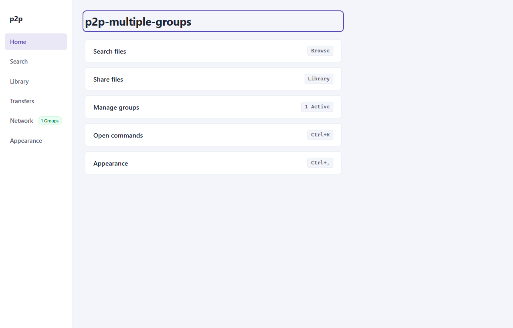

# User Guide: Getting Started

This guide walks you through setting up and launching the **`p2p-multiple-groups`** desktop application, navigating its interface, and using global productivity shortcuts.

---

## 1. System Requirements

Before running the application, ensure your host environment satisfies the following minimum requirements:

- **Node.js**: Version `>=24.12.0` is strictly enforced via `package.json` engines. The runtime was verified against Node `v24.18.0`.
- **Operating System**:
  - Windows 10/11 (64-bit)
  - macOS 12 Monterey or newer (Intel & Apple Silicon)
  - Linux (Ubuntu 22.04 LTS+, Fedora 38+, or Debian 12+) with DBus and Secret Service installed for secure credential persistence.
- **Network Ports**: Outbound WebSocket access to the configured signaling port (default `8787`) and UDP/TCP ports for WebRTC direct or relayed media/data channels.

---

## 2. Installation & Setup

1. **Clone the Repository**:
   ```bash
   git clone https://github.com/your-org/p2p-multiple-groups.git
   cd p2p-multiple-groups
   ```

2. **Install Dependencies**:
   ```bash
   npm install
   ```

3. **Compile Application Bundles**:
   The project uses `electron-vite` with three compilation targets (`main`, `preload`, and `renderer`):
   ```bash
   npm run build
   ```
   This runs static TypeScript checks for Node and Web environments, compiling output assets to `./out/main/`, `./out/preload/`, and `./out/renderer/`.

4. **Launch the Application**:
   - **Development Mode** (with Hot Module Replacement):
     ```bash
     npm run dev
     ```
   - **Production Preview**:
     ```bash
     npm run start
     ```

---

## 3. Desktop UI Structure

The desktop interface adheres to modern accessible desktop conventions. It is partitioned into two primary functional areas:


*Figure 1: Home dashboard displaying system health, fast-path action rows, and global navigation rail.*

### Navigation Rail (Left Sidebar)
The left navigation rail provides instant access to the application's core views:
- **Home**: Overview of network connectivity, quick-access triggers for search, sharing, groups, and command palette.
- **Search**: Scoped multi-group search engine to locate files across connected peers.
- **Library**: Local shared directory manager with background SHA-256 fingerprinting and group access grant controls.
- **Transfers**: Active transfer monitor tracking chunk streams, download speeds, and route types (Direct vs TURN relay).
- **Network**: Virtual group membership manager, connection status, peer rosters, and supernode assignment inspector.
- **Appearance**: Theme customization engine (System, Dark, Light).

### Main Workspace (Center Viewport)
The active view renders dynamically within the central workspace `#workspace-main`. Upon switching views, focus is automatically transferred to the view's primary heading (`workspaceHeadingRef`), ensuring screen reader compatibility and accessible keyboard navigation.

---

## 4. Keyboard Shortcuts & Command Palette

`p2p-multiple-groups` includes a full keyboard-driven navigation system.

### Command Palette (`Ctrl+K` / `Cmd+K`)
Pressing `Ctrl+K` (Windows/Linux) or `Cmd+K` (macOS) opens the global command palette modal:
- Filter commands by typing keywords (e.g., `Search`, `Library`, `Theme`, `Network`).
- Use `ArrowUp` and `ArrowDown` to navigate results.
- Press `Enter` to execute the selected command.
- Press `Escape` to dismiss the palette and return focus to your previous active element.

### Default Keybindings

| Shortcut (Win / Linux) | Shortcut (macOS) | Action | Target View / Event |
|---|---|---|---|
| `Ctrl+K` | `Cmd+K` | Toggle Command Palette | Opens Command Palette dialog |
| `Ctrl+,` | `Cmd+,` | Preferences | Switches to Appearance view |
| `Escape` | `Escape` | Dismiss Modal / Cancel | Closes dialogs or active modals |

---

## 5. Next Steps

Now that your client is running, proceed to join a virtual group or set up your shared library:
- [02. Network & Virtual Groups](02-network-and-groups.md) — Learn how to join groups using cryptographic invitations.
- [03. Library & File Grants](03-library-and-sharing.md) — Add local files and manage group permissions.
- [06. Signaling Server Operations](06-signaling-and-ops.md) — Host your own local signaling server.
