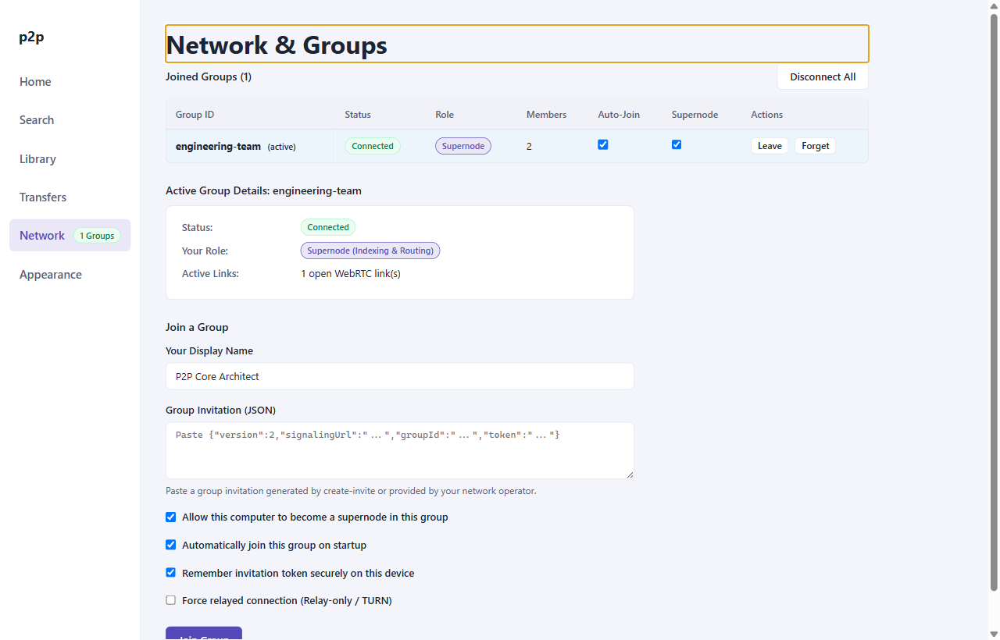

# User Guide: Network & Virtual Groups

The core architectural innovation of **`p2p-multiple-groups`** is the separation of physical WebRTC transport associations from logical **Virtual Groups**. A single node can participate in dozens of isolated swarms simultaneously without leaking catalogs, queries, or transfer traffic across group boundaries.

---

## 1. Core Concepts

### Virtual Groups & Group Keys
A virtual group represents a cryptographically isolated cluster of peers coordinated by a signaling endpoint. Every group is uniquely identified by a canonical **Group Key**:

$$\text{GroupKey} = \text{signalingUrl} \parallel \text{"#"} \parallel \text{groupId}$$

For example:
```text
ws://127.0.0.1:8787/signal#engineering-team
```
Two groups on the same signaling server with different `groupId`s are strictly disjoint. Conversely, two groups with identical `groupId`s hosted on different signaling servers are completely independent.

### Two-Tier Roster Topology
Peers in a group occupy one of two roles:
1. **Supernodes**: High-capacity nodes elected to aggregate inverted search catalogs from leaf nodes and route search queries.
2. **Ordinary Peers**: Leaf nodes that maintain connections to primary and standby supernodes, conserving network overhead and CPU cycles.

---

## 2. Network View Interface

The **Network & Groups** view provides real-time visibility into all active memberships and local connection states:


*Figure 1: Network & Groups view showing the active groups table, selected group telemetry, and join form.*

The interface consists of three primary sections:
- **Joined Groups Table**: Overview of all saved and active groups, showing group ID, connection status, node role, member count, auto-join toggle, supernode eligibility toggle, and actions (`Leave`, `Forget`).
- **Active Group Details Panel**: Detailed telemetry for the selected group, displaying connection health, assigned primary and standby supernodes, and the count of open WebRTC links.
- **Join a Group Form**: Form to submit cryptographic invitations and configure display name, supernode eligibility, auto-join, credential remembering, and privacy mode.

---

## 3. Joining a Virtual Group

To join a group, you must obtain an invitation string from a signaling server operator or existing peer.

### Invitation Formats
The client supports both V1 and V2 invitation payloads:

**V2 Invitation (Current Standard)**:
```json
{
  "version": 2,
  "signalingUrl": "ws://127.0.0.1:8787/signal",
  "groupId": "engineering-team",
  "token": "a1b2c3d4...base64url-token..."
}
```

**V1 Invitation (Legacy Compatibility)**:
```json
{
  "version": 1,
  "signalingUrl": "ws://127.0.0.1:8787/signal",
  "roomId": "engineering-team",
  "token": "legacy-token..."
}
```

### Join Procedure
1. Navigate to the **Network** view.
2. Under **Join a Group**, enter your desired **Display Name** (1–32 characters).
3. Paste the invitation JSON string into the **Invitation JSON** field.
4. Configure optional settings:
   - **Supernode Eligible**: Check this if your machine has stable bandwidth and open ports to assist in indexing and routing queries for the group.
   - **Auto-join on launch**: Check this to automatically reconnect to this group whenever the desktop application starts.
   - **Remember invitation securely**: Saves credentials encrypted on disk via OS keychain. If unchecked, credentials are held only in memory for the current process session.
   - **Privacy Mode (Relay Only)**: Enforces TURN-only relay connections, concealing your public IP address from other peers.
5. Click **Join Group**.

---

## 4. Credential Persistence Modes

The application supports two distinct credential storage strategies:

1. **Hardware-Backed Encryption (`SafeCredentialStore`)**:
   - Enabled by checking **Remember invitation securely**.
   - Tokens are encrypted using Electron's `safeStorage` API:
     - **Windows**: Data Protection API (DPAPI) tied to your user account.
     - **macOS**: Keychain Services.
     - **Linux**: Secret Service API via DBus (e.g., GNOME Keyring, KWallet).
   - Encrypted tokens are stored in `credentials.enc` under your application data directory with restrictive file permissions (`0o600`).
2. **Session-Only Ephemeral Memory**:
   - Used when **Remember invitation securely** is unchecked or when OS keychain services are unavailable.
   - Credentials exist strictly in heap memory during the active Electron session and are discarded upon exit.

---

## 5. Network Lifecycle States

The network connection for each virtual group transitions through distinct states:

| Status | Meaning | Operational Behavior |
|---|---|---|
| `disconnected` | Node is idle or explicitly disconnected. | No WebRTC connections or signaling sockets are open. |
| `connecting` | Signaling handshake or ICE gathering in progress. | Client is negotiating SDP offers/answers over WebSocket. |
| `connected` | Signaling link and WebRTC mesh established. | Full search, indexing, and direct file transfers enabled. |
| `degraded` | Primary supernode unreachable; standby failover active. | Read-only search available; catalog sync pending election. |
| `recovering` | Signaling heartbeat interrupted; reconnect retry active. | Monotonic sequence validation prevents stale state ingestion. |
| `error` | Fatal authentication failure or invalid token. | Sockets closed; action required (check credentials). |

---

## 6. Privacy Mode (`relayOnly`)

When **Privacy Mode** (`relayOnly`) is enabled:
- The WebRTC stack configures `iceTransportPolicy: 'relay'`.
- All peer-to-peer data channels route exclusively through designated Coturn TURN relays.
- **Security Invariant**: Host and Server-Reflexive (STUN) candidates are completely suppressed, preventing peer nodes from discovering your physical or public IP address.
- *Note*: Changing the `relayOnly` policy requires disconnecting all active groups first to ensure that no open direct SCTP associations remain active.

---

## 7. Leaving and Forgetting Groups

The Joined Groups table provides two distinct actions for ending group participation:

1. **Leave Group**:
   - Sends a graceful `leave` message to the signaling server.
   - Tears down WebRTC data channels and SCTP associations tied to this group.
   - Retains the group configuration and credentials in your local store, allowing immediate one-click re-joining.
2. **Forget Group**:
   - Leaves the group if currently connected.
   - Permanently deletes the group from `peer-state.json`.
   - Removes encrypted credentials from `credentials.enc`.
   - **Atomic Grant Revocation**: Automatically revokes access grants for this group across all shared files in your local library, ensuring zero leftover permissions.
