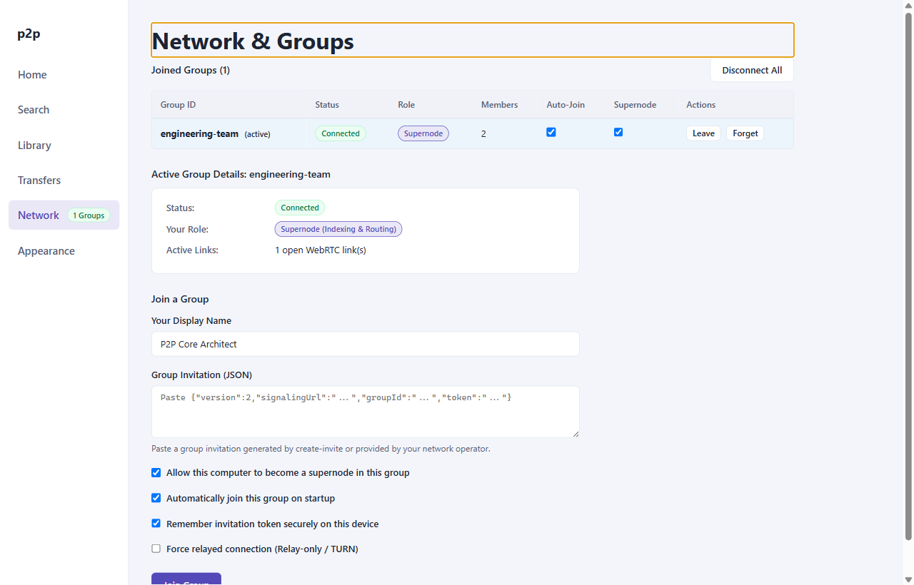

# User Guide: Network & Virtual Groups

The core architectural innovation of **`p2p-multiple-groups`** is the separation of physical WebRTC transport associations from logical **Virtual Groups**. A single node can participate in dozens of isolated swarms simultaneously without leaking catalogs, queries, or transfer traffic across group boundaries.

---

## 1. Core Concepts

### Virtual Groups & Group Keys
A virtual group represents a cryptographically isolated cluster of peers coordinated by a signaling endpoint. Every group is uniquely identified by a canonical **Group Key** serialized as a JSON two-element array:

$$\text{GroupKey} = \text{JSON.stringify}([\text{signalingUrl}, \text{groupId}])$$

For example:
```json
["ws://127.0.0.1:8787/signal","engineering-team"]
```
Two groups on the same signaling server with different `groupId`s are strictly disjoint. Conversely, two groups with identical `groupId`s hosted on different signaling servers are completely independent.

### Two-Tier Roster Topology
Peers in a group occupy one of two roles:
1. **Supernodes**: High-capacity nodes elected to aggregate inverted search catalogs from leaf nodes and route search queries.
2. **Ordinary Peers**: Leaf nodes that maintain connections to primary and standby supernodes, conserving network overhead and CPU cycles.

---

## 2. Network View Interface

The **Network & Groups** view provides real-time visibility into all active memberships and local connection states:


*Figure 1: Network & Groups view showing the active groups table, selected group telemetry, and join form.*

The interface consists of three primary sections:
- **Joined Groups Table**: Overview of all saved and active groups, showing group ID, connection status, node role (Supernode vs. Ordinary, plus Owner badge), member count, auto-join toggle, supernode eligibility toggle, and actions (`Leave`, `Forget`).
- **Active Group Details Panel**: Detailed telemetry for the selected group, displaying connection health, owner information, short invite code copy button, assigned primary and standby supernodes, and open WebRTC links.
- **Create & Join Form**: Tabbed or selectable form allowing users to either **Create Group** as the authoritative owner or **Join Group** using a short invite code or V2 invitation JSON.
---

## 3. Creating & Joining Virtual Groups

### 3.1. Creating a Virtual Group (Owner Mode)
To establish a brand-new virtual group:
1. In the **Network & Groups** view, select **Create Group**.
2. Enter your desired **Group ID** (1–64 characters, letters, numbers, hyphens, and underscores).
3. Specify the **Signaling URL** (defaults to `ws://127.0.0.1:8787/signal` or your configured server).
4. Click **Create & Join**:
   - The signaling server verifies the group ID is available, generates a cryptographically secure 256-bit group token, an initial base64url short invite code, and a 32-byte `ownerSecret`.
   - Your client automatically saves the `ownerSecret` securely in the OS keychain via `SafeCredentialStore` under the key `${groupKey}:owner`.
   - Your node is registered as the authoritative **Owner** of the group.

### 3.2. Joining an Existing Virtual Group
To join a group, you can use either a compact **Short Invite Code** or a **V2 Invitation JSON**:

**1. Short Invite Code (Recommended)**:
```text
eng_team_invite_7k9Xm2Pq4w
```
Compact 8–64 character base64url strings generated by group owners or signaling operators (`npm run signal:invite -- --code-only`).

**2. V2 Invitation JSON**:
```json
{
  "version": 2,
  "signalingUrl": "ws://127.0.0.1:8787/signal",
  "groupId": "engineering-team",
  "token": "a1b2c3d4...base64url-token..."
}
```

### Join Procedure
1. Navigate to the **Network** view and select **Join Group**.
2. Enter your desired **Display Name** (2–32 characters).
3. Paste either the **Short Invite Code** or **V2 Invitation JSON** into the input field.
4. Configure optional settings:
   - **Supernode Eligible**: Enable if your machine has stable bandwidth to assist in query routing.
   - **Auto-join on launch**: Automatically connects whenever the application starts.
   - **Remember invitation securely**: Encrypts credentials via OS keychain.
   - **Privacy Mode (Relay Only)**: Enforces TURN-only relay routing.
5. Click **Join Group**.

---

## 4. Group Ownership, Invite Rotation & Member Management

Peers who create a group hold authoritative ownership verified via their 32-byte `ownerSecret`:

1. **Owner Role Badge**: The UI displays a gold **Owner** badge next to the group status.
2. **Copying Invite Codes**: Owners can copy the active short invite code with one click to invite peers.
3. **Rotating Invite Codes (`rotateGroupInvite`)**:
   - If an invite code is leaked or needs refreshing, the owner can click **Rotate Invite**.
   - The client sends a signed `rotate-invite` message with the `ownerSecret`.
   - The signaling server generates a new invite code and broadcasts `invite-rotated` to all connected group members without dropping active connections.
   - Stale invite codes immediately fail authentication.
4. **Removing Members (`removeGroupMember`)**:
   - Owners can evict abusive or unwanted nodes from the group roster.
   - The owner clicks **Remove** next to the peer in the roster table.
   - The signaling server validates the owner secret, disconnects the target peer with `group-kicked`, and broadcasts an updated roster.
5. **Automatic Server-Restart Reseeding**:
   - If the signaling server restarts and loses ephemeral group state, an owner reconnecting with their cached `ownerSecret` automatically restores the group with full owner permissions.

## 5. Credential Persistence Modes

The application supports two distinct credential storage strategies:

1. **Hardware-Backed Encryption (`SafeCredentialStore`)**:
   - Enabled by checking **Remember invitation securely**.
   - Tokens are encrypted using Electron's `safeStorage` API:
     - **Windows**: Data Protection API (DPAPI) tied to your user account.
     - **macOS**: Keychain Services.
     - **Linux**: Secret Service API via DBus (e.g., GNOME Keyring, KWallet).
   - Encrypted tokens are stored in `credentials.enc` under your application data directory with restrictive file permissions (`0o600`).
2. **Session-Only Ephemeral Memory**:
   - Used when **Remember invitation securely** is unchecked or when OS keychain services are unavailable.
   - Credentials exist strictly in heap memory during the active Electron session and are discarded upon exit.

---

## 6. Network Lifecycle States

The network connection for each virtual group transitions through distinct states:

| Status | Meaning | Operational Behavior |
|---|---|---|
| `disconnected` | Node is idle or explicitly disconnected. | No WebRTC connections or signaling sockets are open. |
| `connecting` | Signaling handshake or ICE gathering in progress. | Client is negotiating SDP offers/answers over WebSocket. |
| `connected` | Signaling link and WebRTC mesh established. | Full search, indexing, and direct file transfers enabled. |
| `degraded` | Primary supernode unreachable; standby failover active. | Read-only search available; catalog sync pending election. |
| `recovering` | Signaling heartbeat interrupted; reconnect retry active. | Monotonic sequence validation prevents stale state ingestion. |
| `error` | Fatal authentication failure or invalid token. | Sockets closed; action required (check credentials). |

---

## 7. Privacy Mode (`relayOnly`)

When **Privacy Mode** (`relayOnly`) is enabled:
- The WebRTC stack configures `iceTransportPolicy: 'relay'`.
- All peer-to-peer data channels route exclusively through designated Coturn TURN relays.
- **Security Invariant**: Host and Server-Reflexive (STUN) candidates are completely suppressed, preventing peer nodes from discovering your physical or public IP address.
- *Note*: Changing the `relayOnly` policy takes effect live; the transport manager immediately switches connection negotiation policies for all active swarms.

---

## 8. Leaving and Forgetting Groups

The Joined Groups table provides two distinct actions for ending group participation:

1. **Leave Group**:
   - Sends a graceful `leave` message to the signaling server.
   - Tears down WebRTC data channels and SCTP associations tied to this group.
   - Retains the group configuration and credentials in your local store, allowing immediate one-click re-joining.
2. **Forget Group**:
   - Leaves the group if currently connected.
   - Permanently deletes the group from `peer-state.json`.
   - Removes encrypted credentials from `credentials.enc`.
   - **Atomic Grant Revocation**: Automatically revokes access grants for this group across all shared files in your local library, ensuring zero leftover permissions.
