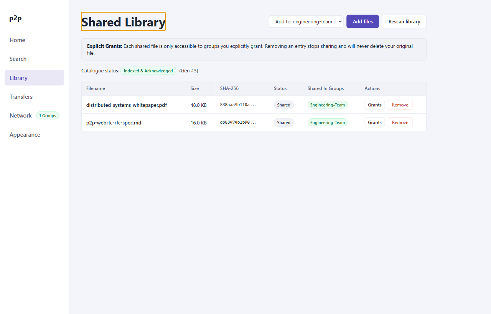

# User Guide: Library & File Sharing

The **Library** view manages the files you publish to the P2P network. It implements fine-grained group access control, content-addressable SHA-256 fingerprinting, background verification pipelines, and atomic capability revocation.

---

## 1. Library Interface

The **Shared Library** screen displays all locally tracked files, their verification status, storage footprints, and virtual group grants:

*Figure 1: Library view displaying shared files, cryptographic status badges, sizes, and group grant assignments.*

### Screen Elements
- **Share Files Button**: Opens the native OS file picker to add files to the shared catalog.
- **Rescan Library Button**: Triggers a background pass verifying file presence, timestamps (`mtime`), and integrity on disk.
- **Shared Files Table**: Displays file name, on-disk path, human-readable size, cryptographic status, active group grant tags, and item action controls (`Manage Groups`, `Remove`).

---

## 2. Adding Files to the Library

Files can be added to your library using the native desktop file picker:

1. Click **Share Files** in the Library view header.
2. Select one or more files from your filesystem.
3. The application registers each file in the `MultiGroupPeerStore` and initiates the background hashing pipeline.
4. If a default group is currently selected in the UI dropdown, access is immediately granted to that group; otherwise, the file is added in an ungranted state until you configure its groups.

---

## 3. Cryptographic Hashing Pipeline

To preserve content addressability across dynamic peer networks, all shared files are indexed by their **SHA-256** cryptographic digest.

### Pipeline States

| Status | Badge Color | Description |
|---|---|---|
| `hashing` | Amber / Warning | File is being processed by background worker streams using Node.js `crypto.createHash('sha256')`. |
| `shared` | Green / Success | SHA-256 hash computed successfully; file is published to the catalogs of granted groups. |
| `unavailable` | Red / Error | File path does not exist on disk or file permissions deny read access. |
| `error` | Red / Error | An unrecoverable I/O or filesystem error occurred during streaming. |

### Microtask Coalescing
Hashing runs asynchronously in non-blocking chunked streams. File metadata updates are published to connected supernodes in batched catalog messages ($\le 32$ entries per batch) to prevent network saturation when adding large directories.

---

## 4. Fine-Grained Group Access Grants

Unlike legacy single-network file sharing software, `p2p-multiple-groups` does not broadcast your entire library to every connected peer. Instead, access is governed by per-file **Group Grants**.

### Managing Group Access
1. In the file row, click **Manage Groups** (or click the active group grant pills).
2. An interactive checklist displays all currently joined virtual groups.
3. Toggle checkmarks to grant or revoke access for individual groups:
   - **Checked**: The file's SHA-256 digest, name, and size are advertised in that group's catalog. Peers in that group can locate and download the file.
   - **Unchecked**: The file is strictly invisible to that group.
4. Click **Done** or press `Enter` to commit changes.

### Immediate Dynamic Revocation
When you revoke a group's grant for a file:
- The node dispatches an updated catalog delta to the group's supernodes, immediately removing the entry from the inverted search index.
- If an active download of that file is currently in progress with a peer from the revoked group, the next chunk dispatch check fails with `FORBIDDEN: File grant revoked`, immediately terminating the data channel.
- Transfers belonging to other groups sharing the same physical WebRTC connection are completely unaffected.

---

## 5. Rescanning the Library

Files may change on disk outside the application. Clicking **Rescan Library** triggers a full synchronization pass:
- Compares filesystem modification timestamps (`mtimeMs`) and sizes against cached metadata.
- If a file's timestamp or size has changed, its status reverts to `hashing` and a new SHA-256 digest is computed.
- If a file is missing or inaccessible, its status is marked `unavailable`, and catalog advertisements are temporarily withheld from supernodes.

---

## 6. Removing Files from the Library

To stop sharing a file across all groups:
1. Click **Remove** in the file row.
2. The file is unregistered from `peer-state.json`.
3. Catalog revocation notices are sent to all previously granted groups.
4. Any active outbound uploads of that file are cleanly aborted.
5. *Note*: The underlying file on your local storage drive is **never deleted**; only the application's sharing registration is removed.
