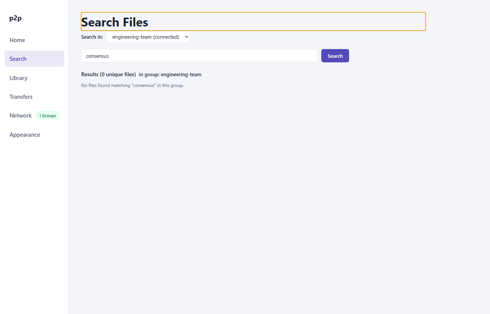

# User Guide: Search & Discovery

The **Search** view allows peers to locate files distributed across the peer-to-peer overlay. By querying supernodes that maintain inverted index catalogs, search queries execute with low latency and without flooding the entire network.

---

## 1. Search Interface

The Search screen provides a scoped query interface with real-time result aggregation:

*Figure 1: Search & Discovery view displaying group selector, search input, status banner, and results table.*

### Key Components
- **Group Selector Dropdown**: Scopes the search operation to one specific joined group. Search queries are never broadcast across multiple groups simultaneously.
- **Query Input Field**: Accepts alphanumeric search strings.
- **Search Button**: Submits the query to the group's designated supernode.
- **Results Table**: Displays matching files, including file name, size, SHA-256 fingerprint, source peer count, and one-click download buttons.

---

## 2. Search Workflow

1. **Select Target Group**: Choose the group you wish to search from the group dropdown menu. You must be in the `connected` state within that group to issue queries.
2. **Enter Search Query**: Type words or terms describing the file you want to locate (e.g., `spec`, `whitepaper`, `consensus`).
3. **Execute Query**: Click **Search** or press `Enter`.
4. **Inspect Results**: Results stream in asynchronously as supernodes return matching catalog records.
5. **Initiate Download**: Click **Download** on any result row to begin transferring the file (see [Transfers & Downloads](05-transfers-and-downloads.md)).

---

## 3. Query Matching Semantics

The search engine implements deterministic, multi-term boolean matching:

### Tokenization & Normalization
1. **Unicode NFKC Normalization**: Inputs undergo canonical unicode normalization to handle accented characters and distinct glyph forms consistently.
2. **Case Folding**: All tokens are folded to lowercase.
3. **Whitespace Splitting**: Queries containing multiple space-separated words are split into individual tokens.

### Boolean AND Semantics
For a file to match a multi-term query, **all tokens** in the query must match against either the file's name or its metadata attributes.
- Example: Searching `p2p spec` matches `p2p-webrtc-rfc-spec.md`.
- Example: Searching `consensus paper` matches `cluster-consensus-raft-paper.pdf`.
- Non-matching terms will exclude the file from the result list.

---

## 4. Search Lifecycle States

The query lifecycle transitions through four distinct operational states:

| State | Indicator | Description |
|---|---|---|
| `idle` | Neutral | No active search query in progress. |
| `searching` | Spinner / Active | Query has been dispatched to the primary supernode; awaiting index match responses. |
| `complete` | Green / Success | Primary supernode successfully executed the index lookup and returned all matching entries. |
| `partial` | Amber / Warning | Primary supernode disconnected or timed out mid-query; standby supernode was consulted to retrieve surviving records. |

### Supernode Loss & Standby Recovery
If the primary supernode becomes unresponsive while a search is active:
1. The client detects the heartbeat or connection loss.
2. The query is automatically re-routed to the designated **Standby Supernode**.
3. Results already accumulated are preserved, and newly discovered sources from the standby supernode are appended without duplicate entries.

---

## 5. Result Aggregation & Swarm Sources

When multiple peers in the same virtual group share identical files (verified by having matching SHA-256 digests):
- The search results table automatically collapses duplicates into a single logical row.
- The **Sources** column indicates the total number of distinct peer endpoints providing that file.
- When you initiate a download, the client automatically balances the download or selects the peer with the lowest latency route.
