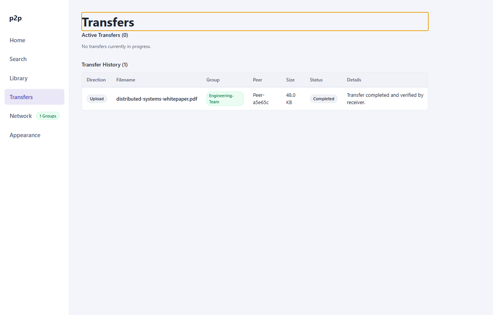

# User Guide: Transfers & Downloads

The **Transfers** view provides end-to-end monitoring and flow management for active and completed file transfers. It displays stream progress, throughput metrics, transport routes (Direct vs TURN Relay), and cryptographic verification receipts.

---

## 1. Transfers Interface

The screen is split into **Active Transfers** and **Completed Transfers**:


*Figure 1: Transfers view displaying active file streams, throughput rates, network paths, and completed transfer receipts.*

### Visible Telemetry
- **File Name**: Name of the resource being uploaded or downloaded.
- **Direction**: Inbound (Download) or Outbound (Upload) arrow indicator.
- **Group Badge**: Virtual group through which the transfer capability was negotiated.
- **Size & Progress**: Byte-level transfer count, percentage progress bar, and real-time chunk throughput (KiB/s or MiB/s).
- **Transport Path**: Route classification: `Direct` (P2P host-to-host) or `Relayed (TURN)`.
- **Status / Action**: Current lifecycle state and interactive controls (`Cancel`, `Search Again`).

---

## 2. Initiating a Download

1. From the [Search](04-search-and-discovery.md) view, click **Download** on a desired file result.
2. A destination prompt allows you to choose where to save the file on your local storage drive (defaults to your operating system's configured `Downloads` directory).
3. The client negotiates a dedicated binary WebRTC data channel with the peer offering the file:
   - Label: `kazaa-file-v2:<fileId>:<groupKey>`
4. The transfer appears immediately in the Active Transfers table.

---

## 3. Real-Time Flow Control & Monitoring

Transfers are divided into uniform $16\text{ KiB}$ binary chunks over WebRTC SCTP data channels:

### Visual Indicators
- **Connecting**: Awaiting WebRTC data channel handshake and capability token verification from the remote peer.
- **Transferring**: Inflight binary chunk stream. The progress bar updates every $256\text{ KiB}$ cumulative window acknowledgement.
- **Verifying**: All payload bytes received; local worker is calculating and checking the final SHA-256 cryptographic digest.
- **Completed**: Hash confirmed valid; file staged and published to destination.
- **Failed**: Transfer terminated due to network timeout, remote rejection, or hash mismatch.

### Direct vs Relayed Route Inspection
The **Path** column reveals the physical transport topology established during ICE candidate gathering:
- **Direct**: Traffic flows peer-to-peer over local UDP/TCP without traversing third-party relays. Offers maximum bandwidth and lowest latency.
- **Relayed (TURN)**: Traffic is proxied through an authoritative Coturn TURN server. This occurs when both peers reside behind restrictive symmetric NATs or when one peer has enabled **Privacy Mode** (`relayOnly`).

---

## 4. Integrity Verification & Filesystem Safety

`p2p-multiple-groups` adheres to zero-trust storage invariants to prevent corrupted or malicious writes:

### 1. Atomic Staging via Temporary Files
Inbound downloads are never written directly to the target destination filename:
1. Bytes stream into a temporary file named:
   ```text
   <targetDirectory>/.tmp.<transferId>
   ```
2. The operating system hides dot-prefixed temporary files from standard file listings.
3. If a transfer is cancelled or fails, the temporary file is immediately unlinked and removed.
4. Only when all bytes have arrived **and** the calculated SHA-256 matches the catalog advertisement is the temporary file atomically renamed to the final filename using `fs.rename()`.

### 2. Path Traversal Sanitation
Peer-provided filenames are strictly sanitized before filesystem operations:
- All directory separators (`/`, `\`), null bytes (`\0`), and relative path traversal tokens (`..`) are stripped via `sanitizeDestinationFileName`.
- Files cannot escape the designated destination directory.

### 3. Collision Protection
If a file with the target name already exists at the destination, the client automatically renames the downloaded file with a numeric increment (e.g., `report (1).pdf`), preventing accidental overwriting of existing local data.

---

## 5. Cancelling an Inflight Transfer

You can terminate a transfer at any time:
1. Locate the active transfer row in the **Active Transfers** section.
2. Click **Cancel**.
3. The client immediately sends a `cancel` transfer control message to the peer, resets the SCTP stream, aborts local disk I/O, and removes the incomplete `.tmp.<transferId>` file.
4. The transfer row transitions to the **Completed Transfers** table with status `cancelled`.
